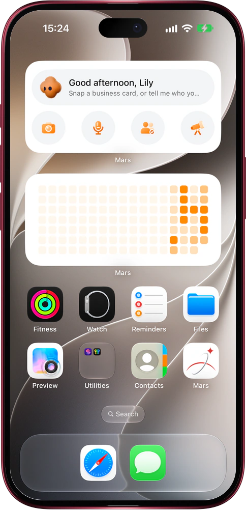

# Mars widgets for iPhone and Mac

> **Preview** · 2026-10-24 · `0.1.1.7959`
> These features are available in the preview version and have not been generally released.

Reach Mars from the Home Screen or the desktop without hunting for the app.

Touch and hold the Home Screen, choose Edit, then Add Widget, and pick Mars. Quick actions shows an orange plush bot that greets you by name for the time of day, with your next event, a person worth reaching out to or a suggestion such as snapping a business card; an event about to start stays until it begins. Its four buttons open a new conversation ready for the camera, voice input, a photo from your library or deep research. Credit usage shows the last weeks of your daily token heatmap, the same as the usage page, and opens that page when tapped. The small credits card shows the share of credits used, used and remaining credits, your plan and when the subscription ends, in light, dark or following the system. On a Mac with the Mars app, right-click the desktop, choose Edit Widgets and search for Mars to place the same widgets on the desktop. On the Lock Screen, add the Mars logo, voice input and camera upload buttons, and a plan and credits bar whose ring shows the share of credits left, with your plan, the percentage left and remaining / total credits. Widgets show what the app last synced: it refreshes them when it opens and when you leave it, so the Lock Screen reflects credits you just spent, and signing out clears them. Siri and Spotlight also offer new chat, voice input, upload screenshot and view reminders.

Capture a business card, a voice note or a research question the moment it comes up, and always know how many credits you have left.

*Illustration using fictional demo data.*

*Illustration using fictional demo data.*

[Explore the preview](https://canary.marsdata.ai/changelog/mars-widgets-on-iphone) · [All updates](../README.md)

[简体中文](./crm-2026-10-24-mars-widgets-on-iphone.zh-CN.md) · [繁體中文](./crm-2026-10-24-mars-widgets-on-iphone.zh-HK.md)
