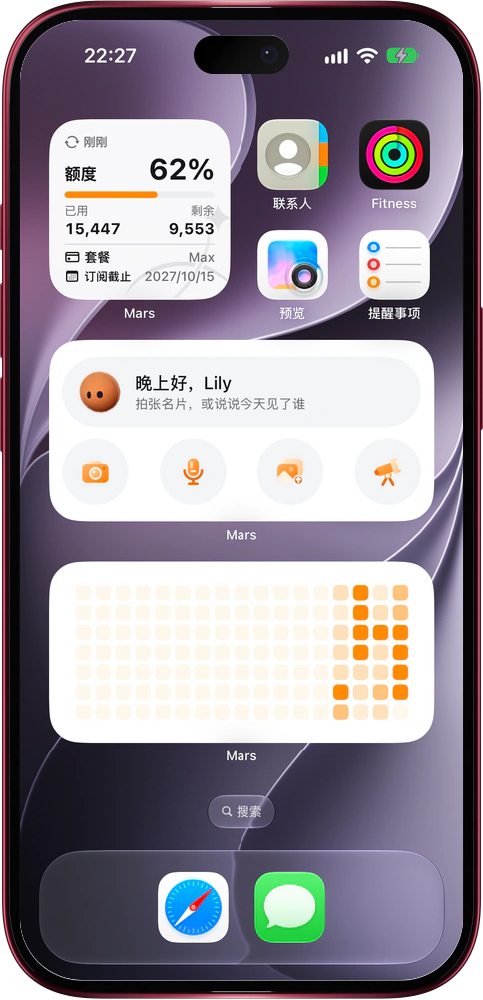

# iPhone 和 Mac 桌面小组件

> **预览** · 2026-10-24 · `0.1.1.7939`
> 以下功能目前处于预览阶段，尚未正式上线。

不用找应用，在主屏幕或桌面上就能叫出 Mars。

长按主屏幕，选择「编辑」→「添加小组件」，找到 Mars 即可。「Mars 快捷入口」上有一只橙色毛绒机器人，按时段叫出你的名字问好；下一行轮流显示即将开始的事件、值得联系的人和「拍张名片」之类的建议，快开始的事件会一直显示到开始。下方四个按钮分别新建一个对话并直接进入拍照、语音输入、从图库上传或深度研究。「额度消耗」显示最近几周每天的 Tokens 消耗热力图，与额度使用情况页一致，点按即可打开该页。小尺寸的「额度卡片」显示已用额度占比、已用和剩余额度、套餐和订阅截止时间，可选浅色、深色或跟随系统。在装有 Mars 的 Mac 上，右键点按桌面，选择「编辑小组件」并搜索 Mars，就能把同样的小组件放到桌面上。在锁屏上可以添加 Mars 标志、语音输入和拍照上传按钮，以及套餐与额度条：圆环显示剩余额度占比，旁边是套餐名称、剩余百分比和剩余 / 总额度。小组件显示的是应用最近一次同步的数据：打开应用和离开应用时都会刷新，所以刚用掉的额度会立即反映在锁屏上；退出登录后小组件会清空。Siri 和聚焦搜索也提供「开启新对话」「语音输入」「上传截图」「查看提醒」四个建议。

名片、语音和想研究的问题，想到就能记下；剩余额度也随时心中有数。

*示意图，使用虚构演示数据。*

*示意图，使用虚构演示数据。*

[体验预览版](https://canary.marsdata.ai/changelog/mars-widgets-on-iphone) · [全部更新](../README.zh-CN.md)

[English](./crm-2026-10-24-mars-widgets-on-iphone.md) · [繁體中文](./crm-2026-10-24-mars-widgets-on-iphone.zh-HK.md)
