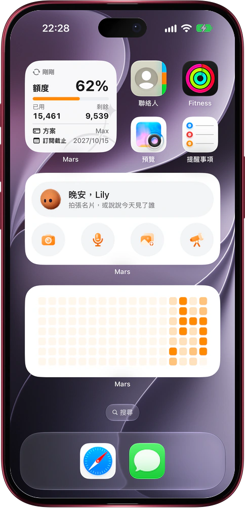

# 不開應用，一點就叫出 Mars

> **預覽** · 2026-10-24 · `0.1.1.7959`
> 以下功能目前處於預覽階段，尚未正式上線。

名片、靈感、想查的問題，往往等不及你去找應用。

在 iPhone 主屏幕、鎖屏和 Mac 桌面添加 Mars 小組件即可。「Mars 快捷入口」上的橙色毛絨機器人按時段叫出你的名字問好，下一行輪流顯示即將開始的事件、值得聯繫的人和「拍張名片」之類的建議，快開始的事件會一直顯示到開始；四個按鈕分別新建對話並直接進入拍照、語音輸入、從圖庫上傳或深度研究。「額度消耗」顯示最近幾週每天的 Tokens 消耗熱力圖，點按即打開額度使用情況頁；小尺寸「額度卡片」顯示已用佔比、已用和剩餘額度、套餐和訂閲截止時間，可選淺色、深色或跟隨系統。鎖屏可添加 Mars 標誌、語音輸入和拍照上傳按鈕，以及套餐與額度條。打開和離開應用時都會刷新，剛用掉的額度會立即反映在鎖屏上；退出登錄後小組件會清空。Siri 和聚焦搜索也提供「開啓新對話」「語音輸入」「上傳截圖」「查看提醒」四個建議。常用入口和剩餘額度就在一眼能看到的地方，不用先打開應用再找功能。

名片、語音和想研究的問題，想到就記下；剩餘額度，隨時心中有數。

*示意圖，使用虛構演示資料。*

*示意圖，使用虛構演示資料。*

[體驗預覽版](https://marsdata.ai/changelog/mars-widgets-on-iphone) · [全部更新](../README.zh-HK.md)

[English](./crm-2026-10-24-mars-widgets-on-iphone.md) · [简体中文](./crm-2026-10-24-mars-widgets-on-iphone.zh-CN.md)
