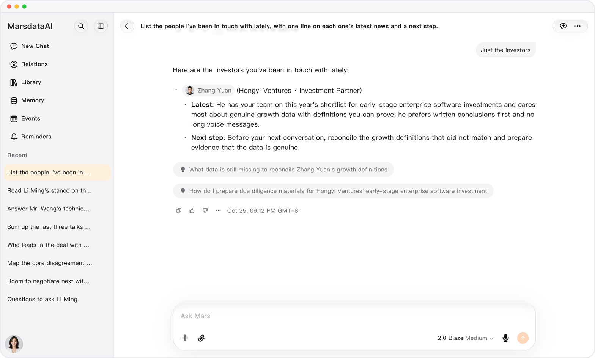
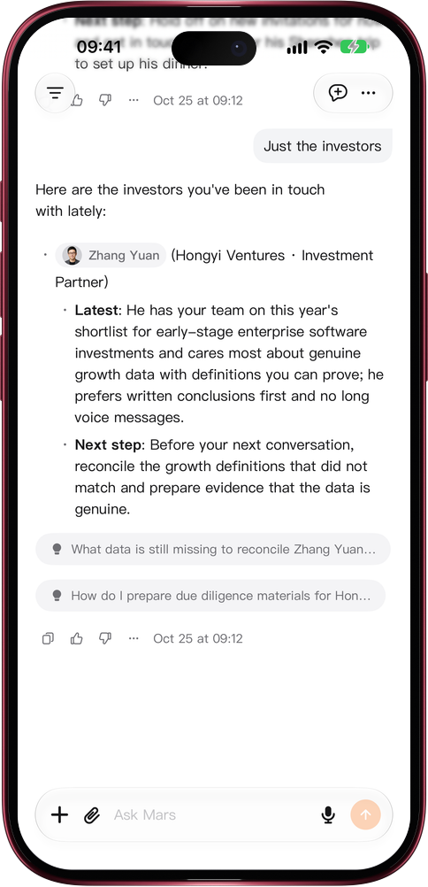

# Add to an answer while it streams

> **Preview** · 2026-10-25 · `0.1.1.8208`
> These features are available in the preview version and have not been generally released.

No more waiting for an answer to end before you can say what you meant.

While Mars is answering, type in the composer as usual: the send button stays available for a text-only draft. Send it and your message appears in the conversation; Mars finishes the part it is writing, then continues below your message with the addition taken into account, for example narrowing a list of contacts to investors only. If the answer ends before your message arrives, it goes out as your next message instead. A draft with files, a composer mode or people waits until the answer ends, and with an empty draft the button still stops the answer. This works on the web and in the iOS app.

Steer an answer the moment you think of something, instead of waiting and asking again.

*Illustration using fictional demo data.*

*Illustration using fictional demo data.*

[Explore the preview](https://canary.marsdata.ai/changelog/add-to-a-running-answer) · [All updates](../README.md)

[简体中文](./crm-2026-10-25-add-to-a-running-answer.zh-CN.md) · [繁體中文](./crm-2026-10-25-add-to-a-running-answer.zh-HK.md)
