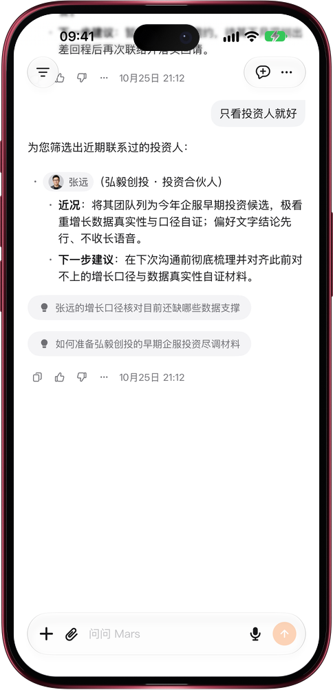

# 回答没写完，想法随时补

> **预览** · 2026-10-25 · `0.1.1.8208`
> 以下功能目前处于预览阶段，尚未正式上线。

话到嘴边，不必等回答结束才说。

Mars 回答时，照常在输入框里打字：只有文字的草稿，发送按钮一直可用。发出后，Mars 写完手头这一段，就在你的消息下方结合补充接着回答，比如把联系人清单缩小到只看投资人；如果回答先结束了，这条消息就作为下一条发出。不用按停止，也不用整段重问，方向说改就改。带有文件、输入框功能或关系人的草稿会等回答结束再发送；草稿为空时，按钮仍是停止回答。网页和 iOS 应用都已支持。

想到就调整方向，不用干等，也不用重问一遍。

*示意图，使用虚构演示数据。*

*示意图，使用虚构演示数据。*

[体验预览版](https://marsdata.ai/changelog/add-to-a-running-answer) · [全部更新](../README.zh-CN.md)

[English](./crm-2026-10-25-add-to-a-running-answer.md) · [繁體中文](./crm-2026-10-25-add-to-a-running-answer.zh-HK.md)
