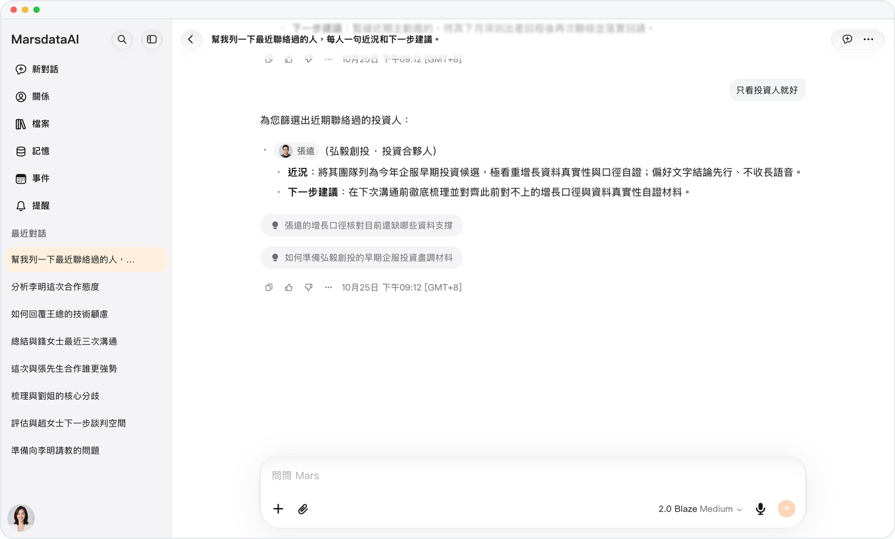
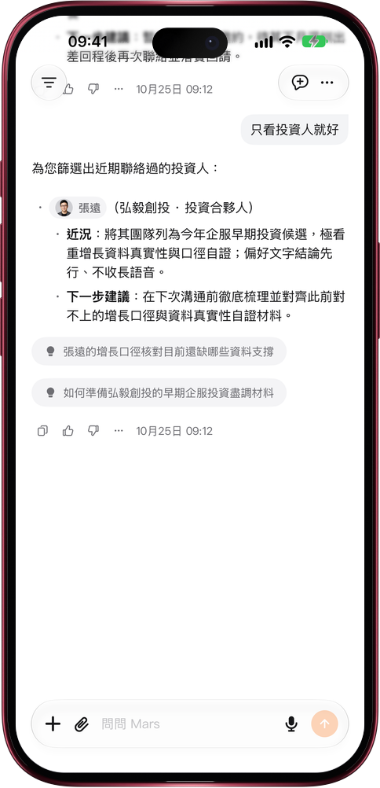

# 回答沒寫完，想法隨時補

> **預覽** · 2026-10-25 · `0.1.1.8208`
> 以下功能目前處於預覽階段，尚未正式上線。

話到嘴邊，不必等回答結束才説。

Mars 回答時，照常在輸入框裏打字：只有文字的草稿，發送按鈕一直可用。發出後，Mars 寫完手頭這一段，就在你的消息下方結合補充接着回答，比如把聯繫人清單縮小到只看投資人；如果回答先結束了，這條消息就作為下一條發出。不用按停止，也不用整段重問，方向説改就改。帶有文件、輸入框功能或關係人的草稿會等回答結束再發送；草稿為空時，按鈕仍是停止回答。網頁和 iOS 應用都已支持。

想到就調整方向，不用幹等，也不用重問一遍。

*示意圖，使用虛構演示資料。*

*示意圖，使用虛構演示資料。*

[體驗預覽版](https://marsdata.ai/changelog/add-to-a-running-answer) · [全部更新](../README.zh-HK.md)

[English](./crm-2026-10-25-add-to-a-running-answer.md) · [简体中文](./crm-2026-10-25-add-to-a-running-answer.zh-CN.md)
