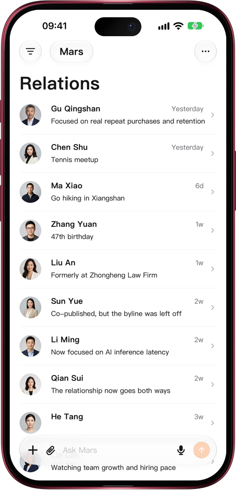

# Mars for Mac

> **Preview** · 2026-10-26 · `0.1.1.8344`
> These features are available in the preview version and have not been generally released.

Mars now has a Mac app, built natively in Swift.

The Mars Mac app comes from the same native Swift code as the iPhone and iPad apps and runs in its own window on the Mac. It opens in the desktop workspace: navigation and recent conversations on the left, lists such as relationships or files in the middle, and the conversation on the right. Sign in with the same account and your conversations, people, files and memory match the web, iPhone and iPad. On the Mac, Contact us opens the support conversation in a dialog inside the app. The Mac app installs through TestFlight. Widgets, sharing to Mars from other apps and Apple Health are available on iPhone and iPad only.

Work through relationships and conversations on a large screen, then carry on from your iPhone.

*Illustration using fictional demo data.*

*Illustration using fictional demo data.*

[Explore the preview](https://canary.marsdata.ai/changelog/mars-for-mac) · [All updates](../README.md)

[简体中文](./crm-2026-10-26-mars-for-mac.zh-CN.md) · [繁體中文](./crm-2026-10-26-mars-for-mac.zh-HK.md)
