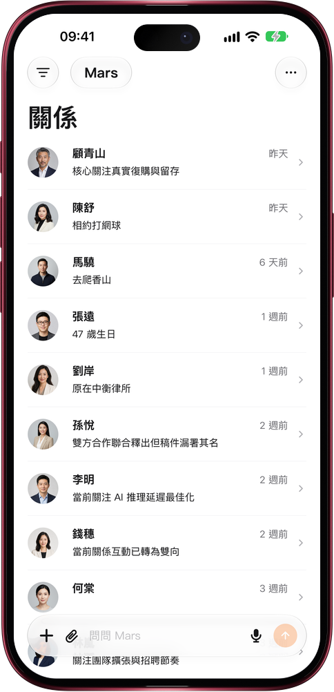

# Mars Mac 原生應用

> **預覽** · 2026-10-26 · `0.1.1.8344`
> 以下功能目前處於預覽階段，尚未正式上線。

Mars 現在有了以原生 Swift 構建的 Mac 應用。

Mars 的 Mac 應用與 iPhone、iPad 應用出自同一套原生 Swift 代碼，在 Mac 上以獨立窗口運行。打開後就是桌面工作區：左側是導航和最近對話，中間是關係、文件等列表，右側是對話。登錄同一個賬號後，對話、聯繫人、文件和記憶與網頁、iPhone、iPad 保持一致。在 Mac 上點按「聯繫我們」，客服對話會在應用內的對話框中打開。Mac 應用通過 TestFlight 安裝。小組件、從其他應用分享到 Mars 和 Apple 健康僅在 iPhone 和 iPad 上提供。

在 Mac 大屏上整理關係和對話，換到 iPhone 也能接着做。

*示意圖，使用虛構演示資料。*

*示意圖，使用虛構演示資料。*

[體驗預覽版](https://canary.marsdata.ai/changelog/mars-for-mac) · [全部更新](../README.zh-HK.md)

[English](./crm-2026-10-26-mars-for-mac.md) · [简体中文](./crm-2026-10-26-mars-for-mac.zh-CN.md)
