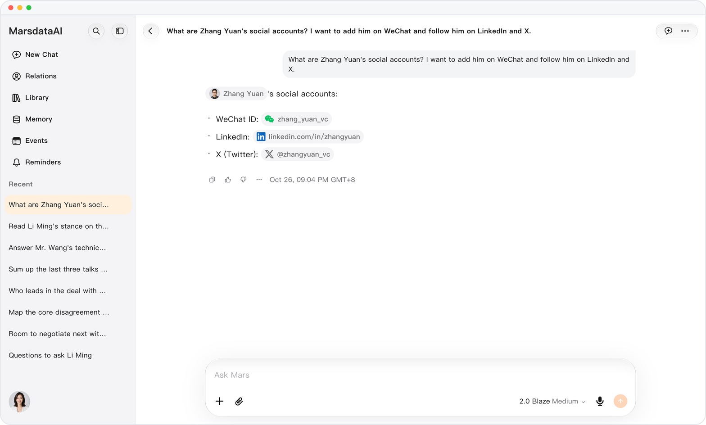
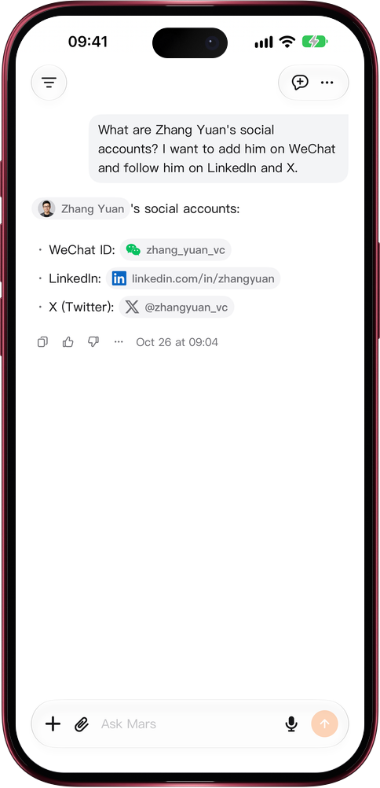

# From their handle to a chat in one tap

> **Preview** · 2026-10-26 · `0.1.1.8385`
> These features are available in the preview version and have not been generally released.

Getting someone's handle shouldn't mean copy, switch apps, search.

Ask something like “What are Zhang Yuan's social accounts?” and Mars lists the accounts saved on that person's record, each as a capsule with its platform's mark. One tap copies the account and opens the app: WeChat, Xiaohongshu, Douyin and similar apps open at their home with the account ready to paste into search; WhatsApp and Telegram open a chat with that person; X, Instagram, LinkedIn, LINE and GitHub open their profile; an account saved as a web address, such as github.com/liming, opens at that address. It covers 21 platforms, on the web and in the iOS app; on iPhone and iPad, a chat or profile link opens in the in-app browser when its app is not installed. No copying, no app switching: you reach them the moment you decide to.

Go from asking about someone to adding them on WeChat or following them, in one step.

*Illustration using fictional demo data.*

*Illustration using fictional demo data.*

[Explore the preview](https://marsdata.ai/changelog/open-social-accounts-in-one-tap) · [All updates](../README.md)

[简体中文](./crm-2026-10-26-open-social-accounts-in-one-tap.zh-CN.md) · [繁體中文](./crm-2026-10-26-open-social-accounts-in-one-tap.zh-HK.md)
