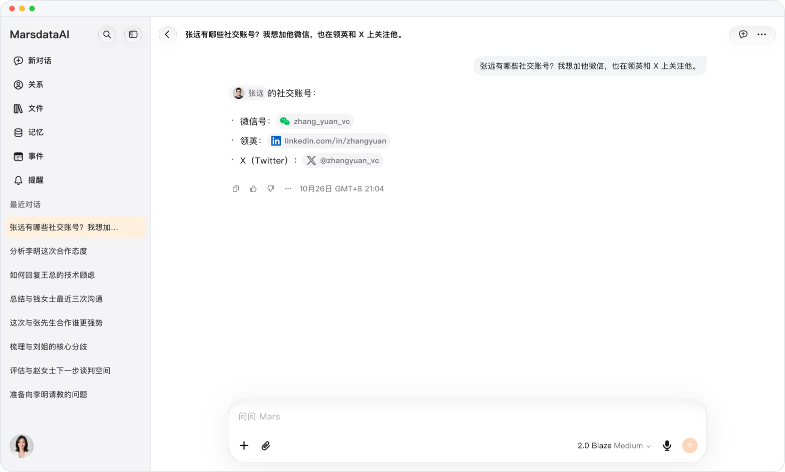

# 一键打开社交账号

> **预览** · 2026-10-26 · `0.1.1.8385`
> 以下功能目前处于预览阶段，尚未正式上线。

问起某人的账号时，回答里的每个账号都能直接使用。

比如问「张远有哪些社交账号？」，Mars 会列出这个人档案里保存的账号，每个账号都显示为带平台标志的胶囊。点按胶囊即复制账号并打开对应应用：微信、小红书、抖音等应用会打开首页，账号可直接粘贴到搜索框；WhatsApp 和 Telegram 会打开与此人的聊天；X、Instagram、领英、LINE 和 GitHub 会打开对方主页。以网址形式保存的账号（例如 github.com/liming）会直接打开该网址。Mars 支持 21 个平台，网页和 iOS 应用都能使用。在 iPhone 和 iPad 上，如果没有安装对应应用，聊天或主页链接会在应用内浏览器中打开。

从问起一个人到加上微信、关注主页，不用再手动复制。

*示意图，使用虚构演示数据。*

*示意图，使用虚构演示数据。*

[体验预览版](https://canary.marsdata.ai/changelog/open-social-accounts-in-one-tap) · [全部更新](../README.zh-CN.md)

[English](./crm-2026-10-26-open-social-accounts-in-one-tap.md) · [繁體中文](./crm-2026-10-26-open-social-accounts-in-one-tap.zh-HK.md)
