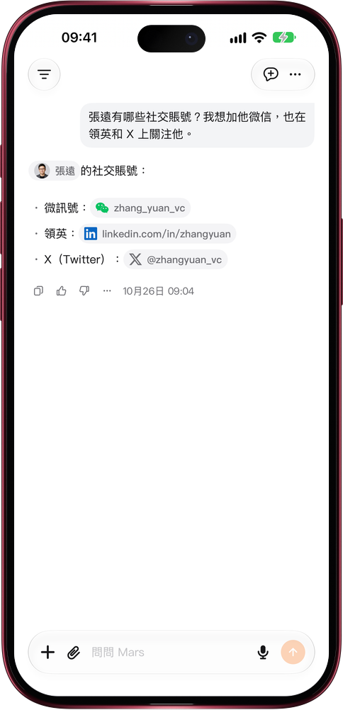

# 問到賬號，一點就聯繫上

> **預覽** · 2026-10-26 · `0.1.1.8385`
> 以下功能目前處於預覽階段，尚未正式上線。

拿到對方賬號，還要複製、切應用、再搜索？

問「張遠有哪些社交賬號？」，Mars 會列出這個人檔案裏保存的賬號，每個都是帶平台標誌的膠囊。點一下即複製賬號並打開對應應用：微信、小紅書、抖音等打開首頁，賬號直接粘進搜索框；WhatsApp 和 Telegram 打開與此人的聊天；X、Instagram、領英、LINE 和 GitHub 打開對方主頁；以網址保存的賬號（例如 github.com/liming）直接打開該網址。支持 21 個平台，網頁和 iOS 應用都能用；在 iPhone 和 iPad 上沒裝對應應用時，鏈接會在應用內瀏覽器中打開。省掉手動複製和切換，想聯繫的那一刻就能聯繫上。

從問起一個人，到加上微信、關注主頁，一步到位。

*示意圖，使用虛構演示資料。*

*示意圖，使用虛構演示資料。*

[體驗預覽版](https://canary.marsdata.ai/changelog/open-social-accounts-in-one-tap) · [全部更新](../README.zh-HK.md)

[English](./crm-2026-10-26-open-social-accounts-in-one-tap.md) · [简体中文](./crm-2026-10-26-open-social-accounts-in-one-tap.zh-CN.md)
