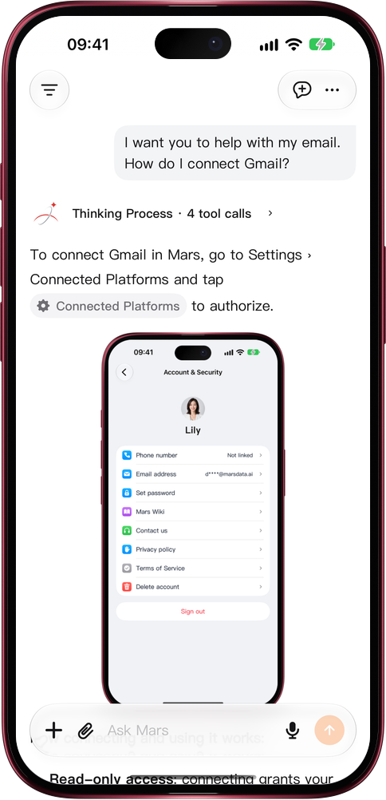

# Open settings from an answer

> **Preview** · 2026-10-27 · `0.1.1.8292`
> These features are available in the preview version and have not been generally released.

When you ask where a setting is, Mars answers with a capsule that takes you straight there.

Ask questions such as "Where is the language setting?" or "How do I connect Gmail?" and Mars answers with a settings capsule marked with a gear, for example Language or Connected Platforms. Tap the capsule and that settings page opens; go back and you return to the same conversation, ready to ask the next question. It works the same on the web, on computers and phones, and in the iOS app.

Find a setting or connect a data source without digging through menus, then carry on with the conversation.

*Illustration using fictional demo data.*

*Illustration using fictional demo data.*

[Explore the preview](https://canary.marsdata.ai/changelog/open-settings-from-an-answer) · [All updates](../README.md)

[简体中文](./crm-2026-10-27-open-settings-from-an-answer.zh-CN.md) · [繁體中文](./crm-2026-10-27-open-settings-from-an-answer.zh-HK.md)
