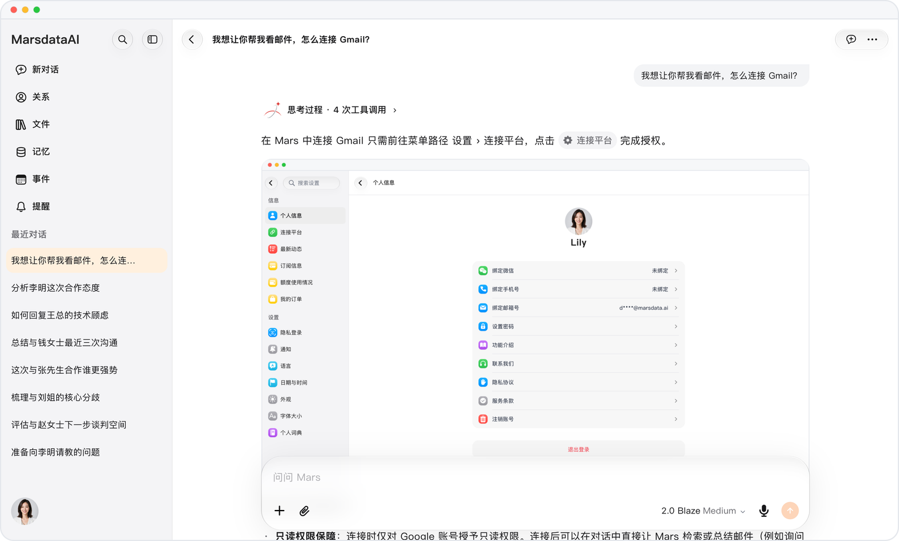
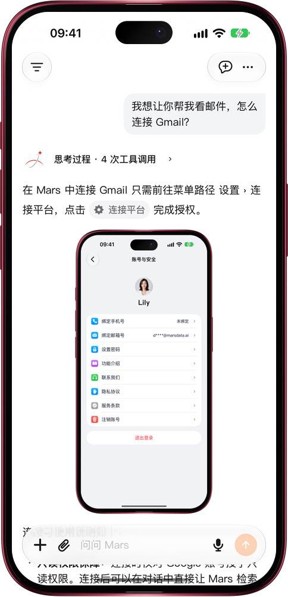

# 从回答直接打开设置

> **预览** · 2026-10-27 · `0.1.1.8292`
> 以下功能目前处于预览阶段，尚未正式上线。

问 Mars 某个设置在哪，回答里会带一个设置胶囊，点按就能直接过去。

问「语言设置在哪」「怎么连接 Gmail」这类问题时，Mars 会在回答里给出带齿轮图标的设置胶囊，例如「语言」「连接平台」。点按胶囊即可打开对应的设置页；返回后回到原来的对话，可以接着问下一个问题。电脑和手机上的网页、iOS 应用都一样。

找设置、连数据不用再翻菜单，设置完回到对话接着聊。

*示意图，使用虚构演示数据。*

*示意图，使用虚构演示数据。*

[体验预览版](https://canary.marsdata.ai/changelog/open-settings-from-an-answer) · [全部更新](../README.zh-CN.md)

[English](./crm-2026-10-27-open-settings-from-an-answer.md) · [繁體中文](./crm-2026-10-27-open-settings-from-an-answer.zh-HK.md)
