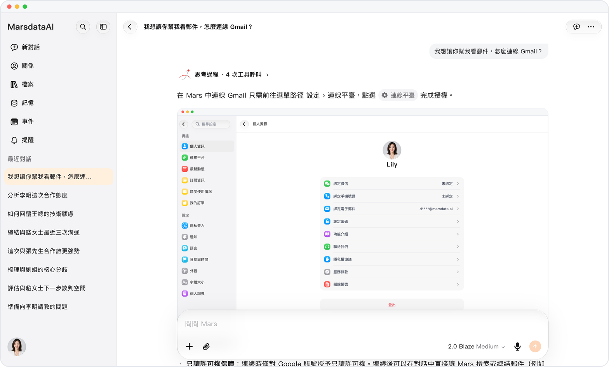

# 從回答直接打開設置

> **預覽** · 2026-10-27 · `0.1.1.8292`
> 以下功能目前處於預覽階段，尚未正式上線。

問 Mars 某個設置在哪，回答裏會帶一個設置膠囊，點按就能直接過去。

問「語言設置在哪」「怎麼連接 Gmail」這類問題時，Mars 會在回答裏給出帶齒輪圖標的設置膠囊，例如「語言」「連接平台」。點按膠囊即可打開對應的設置頁；返回後回到原來的對話，可以接着問下一個問題。電腦和手機上的網頁、iOS 應用都一樣。

找設置、連數據不用再翻菜單，設置完回到對話接着聊。

*示意圖，使用虛構演示資料。*

*示意圖，使用虛構演示資料。*

[體驗預覽版](https://canary.marsdata.ai/changelog/open-settings-from-an-answer) · [全部更新](../README.zh-HK.md)

[English](./crm-2026-10-27-open-settings-from-an-answer.md) · [简体中文](./crm-2026-10-27-open-settings-from-an-answer.zh-CN.md)
