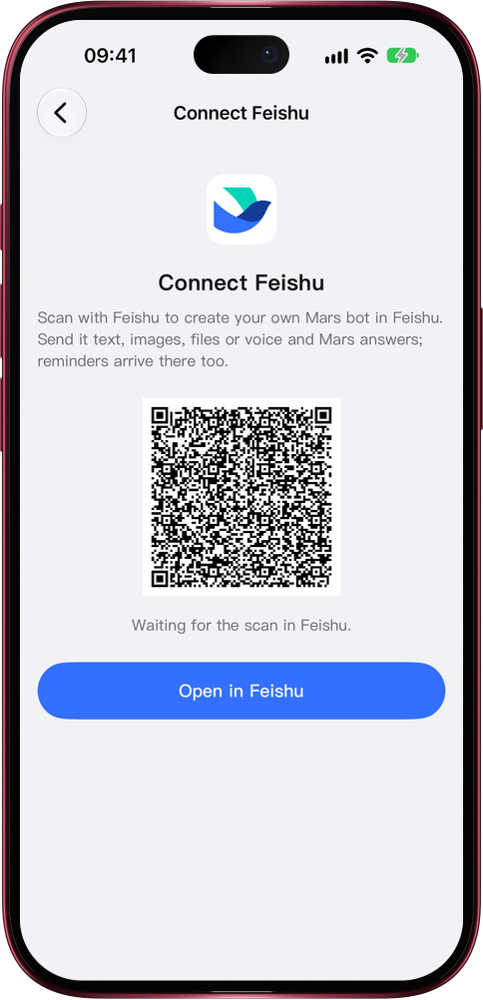

# Mars, inside your Feishu

> **Preview** · 2026-10-28 · `0.1.1.8920`
> These features are available in the preview version and have not been generally released.

Your workday runs in Feishu. Why switch apps to ask Mars?

Open Connect Feishu from Connected Platforms and scan the QR code with Feishu, or tap Open in Feishu on your phone. Mars creates your own bot in your Feishu. Send it a question, a screenshot, a file or a voice message and Mars answers in that chat; event reminders can arrive there too. No app to switch to, no file to forward elsewhere, and only your own chat with the bot gets answers.

Ask Mars where you already work, and never miss a reminder in the app you check all day.

*Illustration using fictional demo data.*

*Illustration using fictional demo data.*

[Explore the preview](https://marsdata.ai/changelog/mars-in-feishu) · [All updates](../README.md)

[简体中文](./crm-2026-10-28-mars-in-feishu.zh-CN.md) · [繁體中文](./crm-2026-10-28-mars-in-feishu.zh-HK.md)
