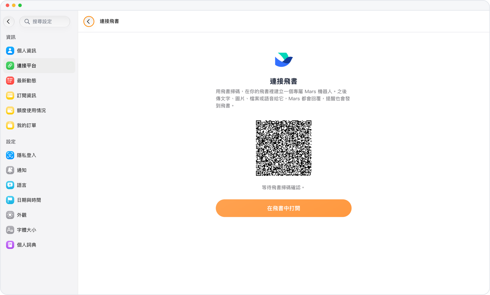

# 不用切應用，飛書裏就能問 Mars

> **預覽** · 2026-10-28 · `0.1.1.8920`
> 以下功能目前處於預覽階段，尚未正式上線。

一天的工作都在飛書裏，問 Mars 還要切出去？

在「連接平台」裏打開「連接飛書」，用飛書掃碼，或在手機上點「在飛書中打開」，Mars 就在你的飛書裏建好一個專屬機器人。把問題、截圖、文件或語音發給它，Mars 直接在對話裏回覆；日程提醒也能發到這裏。不用切換應用，也不用把文件轉來轉去，而且只回復你和機器人的私聊。

在每天都開着的飛書裏問 Mars、收提醒，工作節奏不被打斷。

*示意圖，使用虛構演示資料。*

*示意圖，使用虛構演示資料。*

[體驗預覽版](https://marsdata.ai/changelog/mars-in-feishu) · [全部更新](../README.zh-HK.md)

[English](./crm-2026-10-28-mars-in-feishu.md) · [简体中文](./crm-2026-10-28-mars-in-feishu.zh-CN.md)
