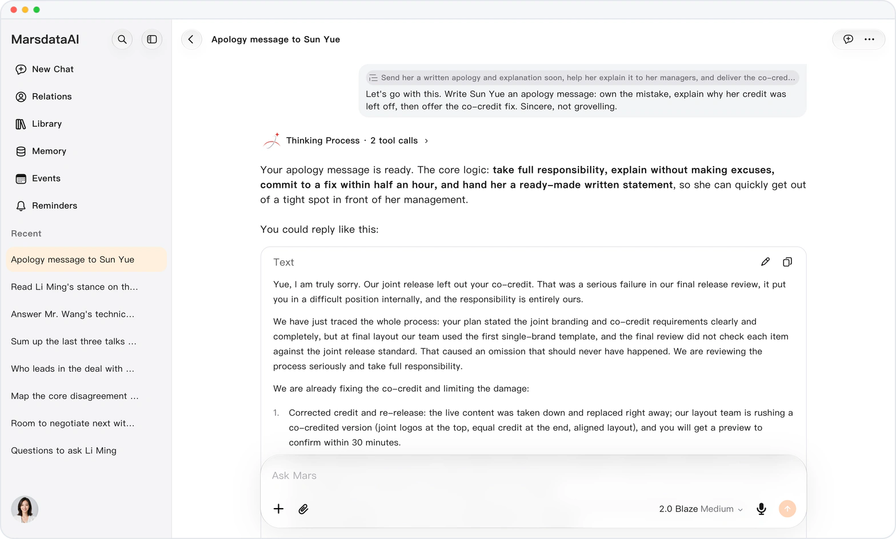
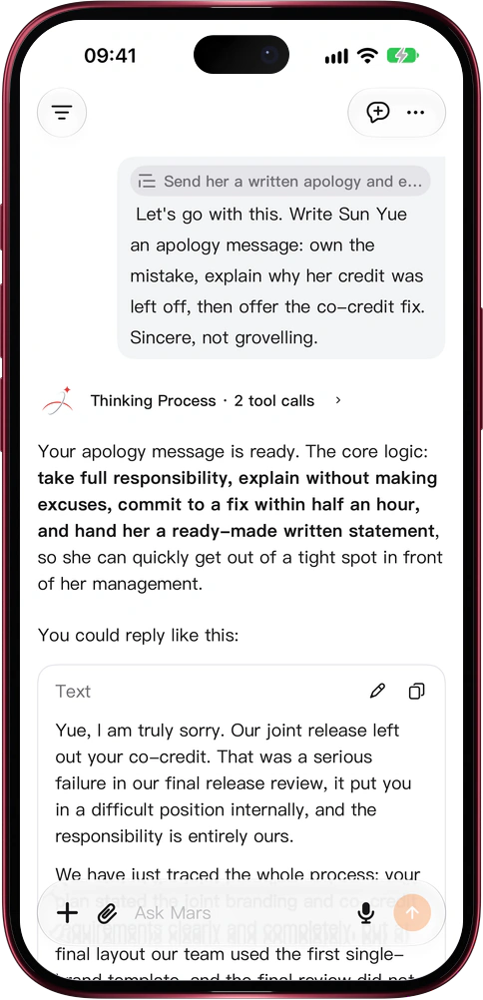

# Build on what Mars already said

> **Preview** · 2026-10-28 · `0.1.1.8920`
> These features are available in the preview version and have not been generally released.

The advice was good. It is just three chats back.

Select a line in any message and choose Quote, or on the web type @ to open a past conversation's messages or search lines across all your chats. The line goes into your question as a quote capsule, and Mars reads that exact passage before it answers. Tap the capsule later and Mars opens that conversation and marks the quoted line in orange. No copying and pasting, no retelling the context, no scrolling to find the source. It works on the web and in the iOS app.

Every earlier answer becomes a starting point, and you can always see where an idea came from.

*Illustration using fictional demo data.*

*Illustration using fictional demo data.*

[Explore the preview](https://canary.marsdata.ai/changelog/quote-past-conversations) · [All updates](../README.md)

[简体中文](./crm-2026-10-28-quote-past-conversations.zh-CN.md) · [繁體中文](./crm-2026-10-28-quote-past-conversations.zh-HK.md)
