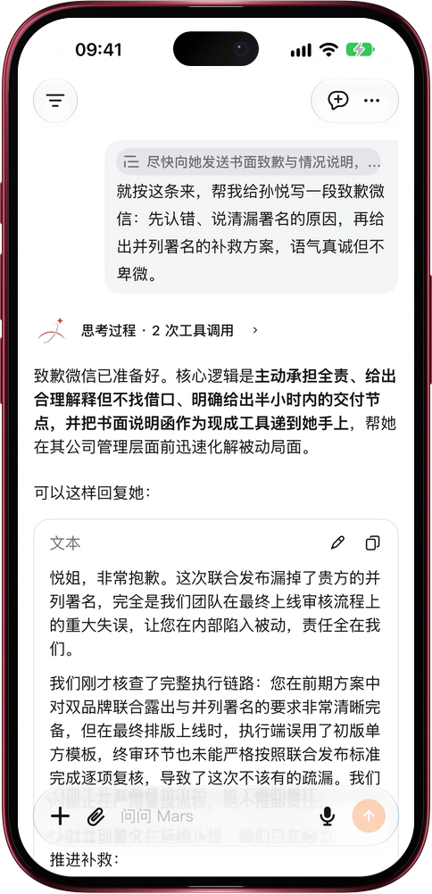

# 说过的那句话，直接拿来接着问

> **预览** · 2026-10-28 · `0.1.1.8920`
> 以下功能目前处于预览阶段，尚未正式上线。

上次那条建议很好，可它在哪段对话里来着？

在任意消息里选中一句话点「引用」；网页上也可以输入 @，打开以前某段对话的消息，或搜索所有对话里的原句。这句话会变成提问里的引用胶囊，Mars 先读这段原话再回答。之后点一下胶囊，就会打开那段对话，并用橙色标出被引用的那一行。不用复制粘贴，不用重讲来龙去脉，也不用翻聊天记录找出处。网页和 iOS 应用都能用。

以前的每个好回答都能接着用，每个想法都找得到出处。

*示意图，使用虚构演示数据。*

*示意图，使用虚构演示数据。*

[体验预览版](https://canary.marsdata.ai/changelog/quote-past-conversations) · [全部更新](../README.zh-CN.md)

[English](./crm-2026-10-28-quote-past-conversations.md) · [繁體中文](./crm-2026-10-28-quote-past-conversations.zh-HK.md)
