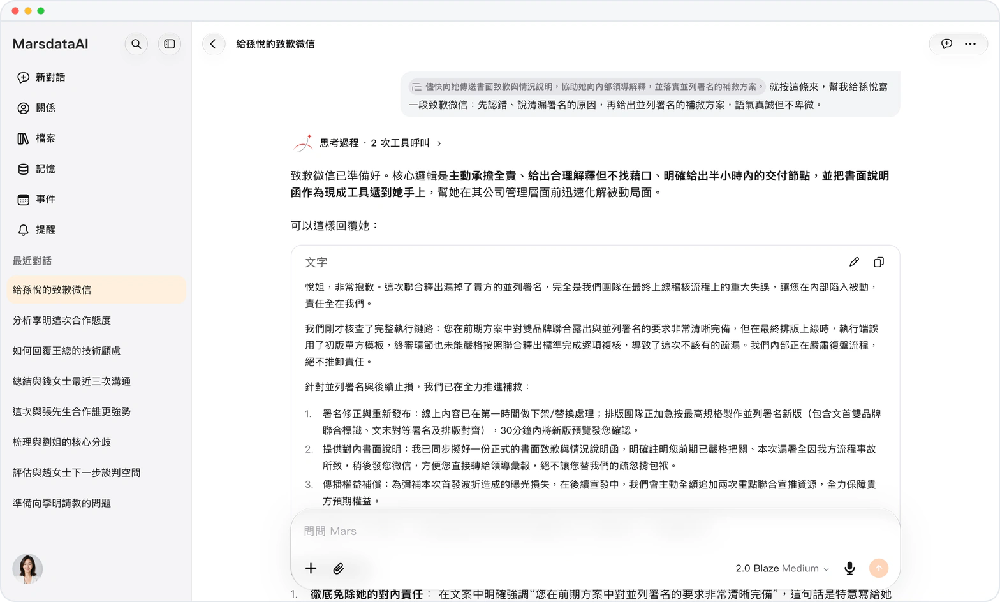
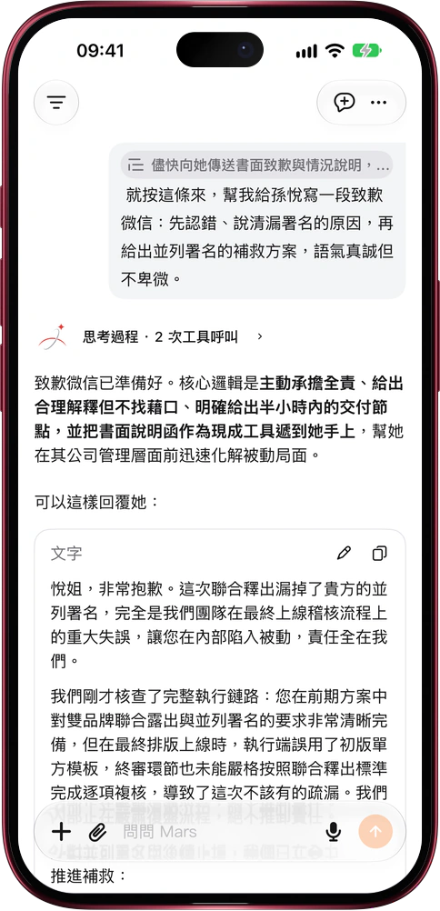

# 説過的那句話，直接拿來接着問

> **預覽** · 2026-10-28 · `0.1.1.8920`
> 以下功能目前處於預覽階段，尚未正式上線。

上次那條建議很好，可它在哪段對話裏來着？

在任意消息裏選中一句話點「引用」；網頁上也可以輸入 @，打開以前某段對話的消息，或搜索所有對話裏的原句。這句話會變成提問裏的引用膠囊，Mars 先讀這段原話再回答。之後點一下膠囊，就會打開那段對話，並用橙色標出被引用的那一行。不用複製粘貼，不用重講來龍去脈，也不用翻聊天記錄找出處。網頁和 iOS 應用都能用。

以前的每個好回答都能接着用，每個想法都找得到出處。

*示意圖，使用虛構演示資料。*

*示意圖，使用虛構演示資料。*

[體驗預覽版](https://marsdata.ai/changelog/quote-past-conversations) · [全部更新](../README.zh-HK.md)

[English](./crm-2026-10-28-quote-past-conversations.md) · [简体中文](./crm-2026-10-28-quote-past-conversations.zh-CN.md)
