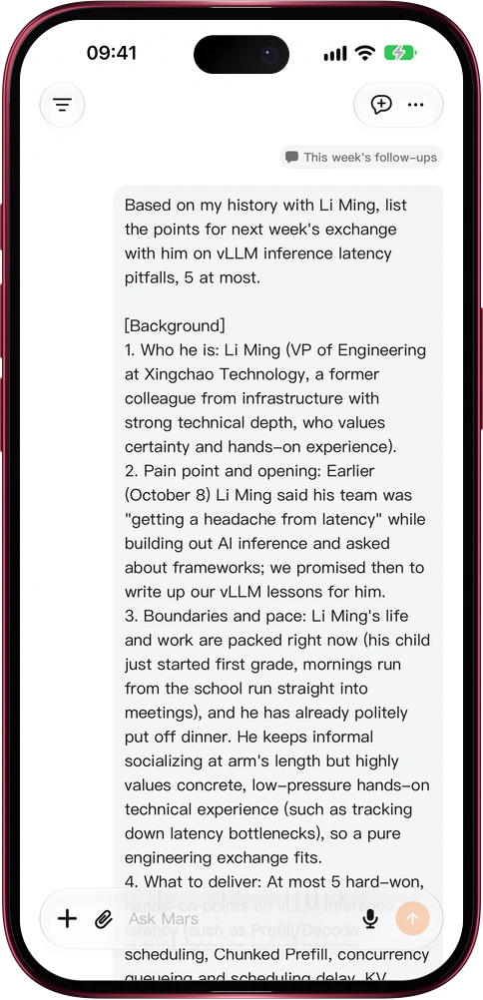

# Mars hands work to a fresh conversation

> **Preview** · 2026-10-31 · `0.1.1.9443`
> These features are available in the preview version and have not been generally released.

A new task comes up mid-chat, and you don't want it to derail the thread you're in.

Tell Mars to start a new conversation for it. Mars creates it under the title you give, writes the background and the ask as its first message, and the new conversation gets to work at once. Mars can also pass a result to another of your conversations: if that one is answering, it takes the message in on the spot; if it is idle, it starts a new answer. Each passed message carries a capsule naming the conversation it came from; tap it to go back there. Messages only travel between your own conversations. No copying and pasting, no retelling the context, and each conversation stays on one job. It works on the web and in the iOS app.

One job per conversation, your main thread uninterrupted, and every handoff traceable to its source.

*Illustration using fictional demo data.*

*Illustration using fictional demo data.*

[Explore the preview](https://marsdata.ai/changelog/conversations-that-hand-off-work) · [All updates](../README.md)

[简体中文](./crm-2026-10-31-conversations-that-hand-off-work.zh-CN.md) · [繁體中文](./crm-2026-10-31-conversations-that-hand-off-work.zh-HK.md)
