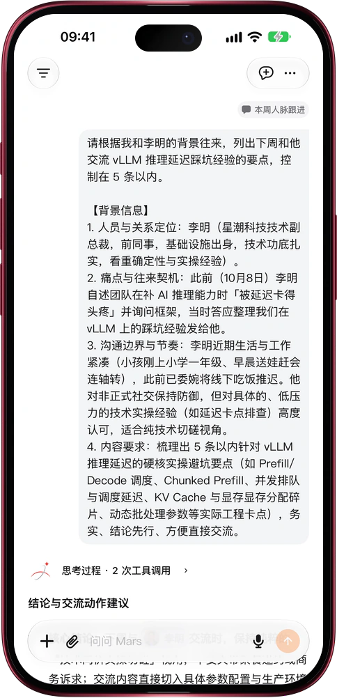

# 一句话，Mars 另开一个对话去办

> **预览** · 2026-10-31 · `0.1.1.9443`
> 以下功能目前处于预览阶段，尚未正式上线。

聊着聊着冒出一件新事，塞进当前对话又怕把话题搅乱？

直接告诉 Mars「新开一个对话来做这件事」，它会按你给的标题建好对话，把背景和要求整理成第一条消息发过去，新对话马上开工。Mars 也能把结果发到你的另一段对话：那边正在回答，就当场接上；那边空闲，就开始新一轮回答。收到的消息上方标着来源对话的胶囊，点一下就回到出处。消息只在你自己的对话之间传递。不用复制粘贴，不用重讲来龙去脉，每段对话专心办一件事。网页和 iOS 应用都能用。

一件事一个对话，主线不被打断，每条消息都查得到从哪儿来。

*示意图，使用虚构演示数据。*

*示意图，使用虚构演示数据。*

[体验预览版](https://marsdata.ai/changelog/conversations-that-hand-off-work) · [全部更新](../README.zh-CN.md)

[English](./crm-2026-10-31-conversations-that-hand-off-work.md) · [繁體中文](./crm-2026-10-31-conversations-that-hand-off-work.zh-HK.md)
