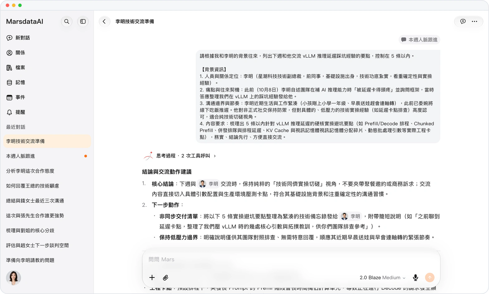
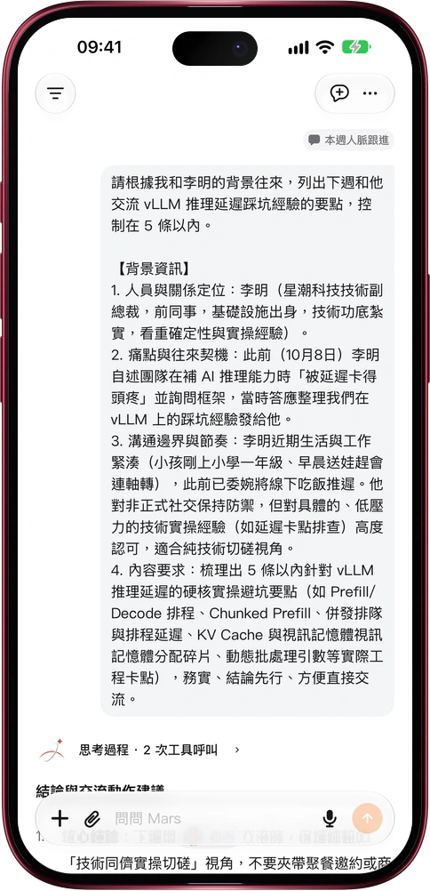

# 一句話，Mars 另開一個對話去辦

> **預覽** · 2026-10-31 · `0.1.1.9443`
> 以下功能目前處於預覽階段，尚未正式上線。

聊着聊着冒出一件新事，塞進當前對話又怕把話題攪亂？

直接告訴 Mars「新開一個對話來做這件事」，它會按你給的標題建好對話，把背景和要求整理成第一條消息發過去，新對話馬上開工。Mars 也能把結果發到你的另一段對話：那邊正在回答，就當場接上；那邊空閒，就開始新一輪迴答。收到的消息上方標着來源對話的膠囊，點一下就回到出處。消息只在你自己的對話之間傳遞。不用複製粘貼，不用重講來龍去脈，每段對話專心辦一件事。網頁和 iOS 應用都能用。

一件事一個對話，主線不被打斷，每條消息都查得到從哪兒來。

*示意圖，使用虛構演示資料。*

*示意圖，使用虛構演示資料。*

[體驗預覽版](https://marsdata.ai/changelog/conversations-that-hand-off-work) · [全部更新](../README.zh-HK.md)

[English](./crm-2026-10-31-conversations-that-hand-off-work.md) · [简体中文](./crm-2026-10-31-conversations-that-hand-off-work.zh-CN.md)
