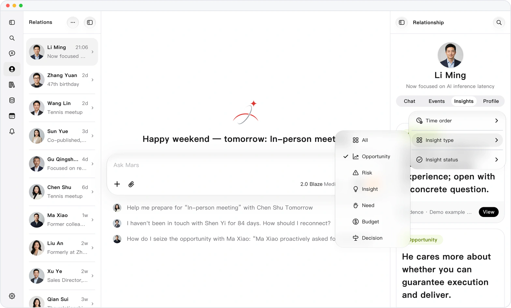
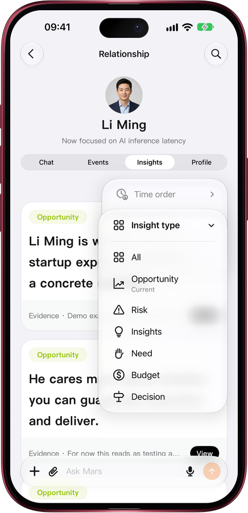

# The insights you need, filtered first

> **Preview** · 2026-10-31 · `0.1.1.9443`
> These features are available in the preview version and have not been generally released.

A dozen insights on one person, and the opportunity you need is buried somewhere in the list.

On a contact's Insights tab, tap the orange sort button: order by time (pinned and unread first, newest, oldest), filter by type (opportunity, risk, insight, need, budget, decision) and by status (active, retired, all). Only active insights show by default, so judgments that no longer hold stay out of the way; choose Retired to look back, and those cards carry a Retired tag. No scrolling card by card: before a deal, look at opportunities; to stay safe, look at risks. It works on the web and in the iOS app.

Every time you open a contact, the judgment you need right now comes first.

*Illustration using fictional demo data.*

*Illustration using fictional demo data.*

[Explore the preview](https://marsdata.ai/changelog/filter-relationship-insights) · [All updates](../README.md)

[简体中文](./crm-2026-10-31-filter-relationship-insights.zh-CN.md) · [繁體中文](./crm-2026-10-31-filter-relationship-insights.zh-HK.md)
