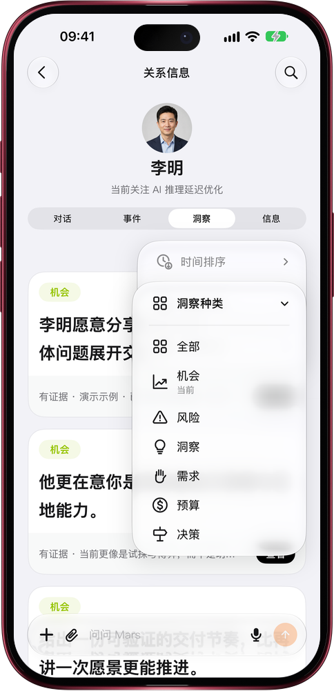

# 洞察一多，先看你要的那一类

> **预览** · 2026-10-31 · `0.1.1.9443`
> 以下功能目前处于预览阶段，尚未正式上线。

一个人攒了十几条洞察，想找那条机会却要从头翻？

在联系人的「洞察」页，点橙色的排序按钮：按时间排（置顶与未读优先、最新、最早），按种类筛（机会、风险、洞察、需求、预算、决策），按状态看（活跃、已退役、全部）。默认只显示活跃洞察，已经失效的判断不再混在里面；想回看时选「已退役」，卡片会标出「已退役」。不用逐条翻找：要谈合作就看机会，要防踩坑就看风险。网页和 iOS 应用都能用。

每次打开联系人，先看到当下最该用的判断。

*示意图，使用虚构演示数据。*

*示意图，使用虚构演示数据。*

[体验预览版](https://marsdata.ai/changelog/filter-relationship-insights) · [全部更新](../README.zh-CN.md)

[English](./crm-2026-10-31-filter-relationship-insights.md) · [繁體中文](./crm-2026-10-31-filter-relationship-insights.zh-HK.md)
