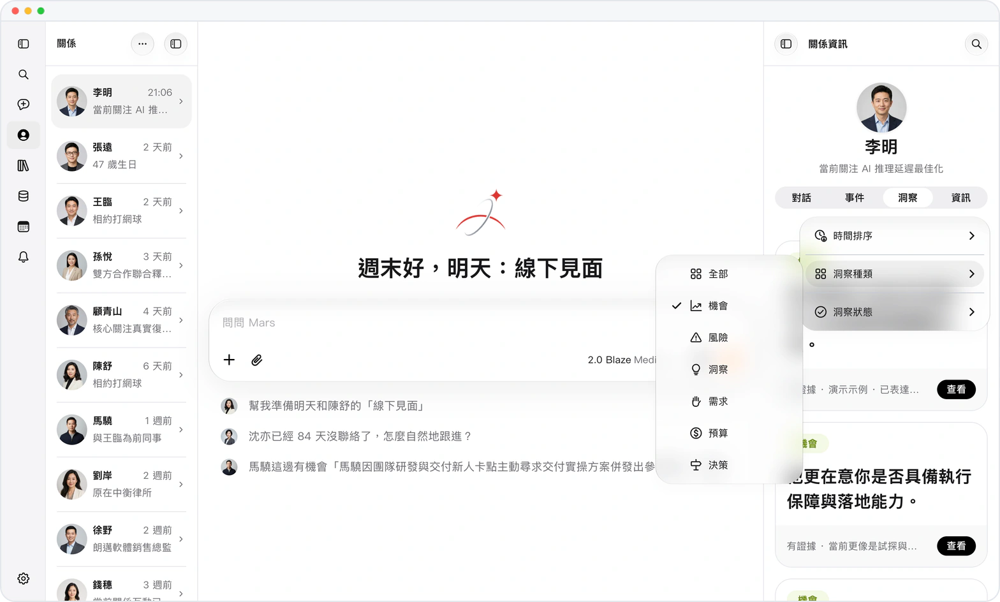
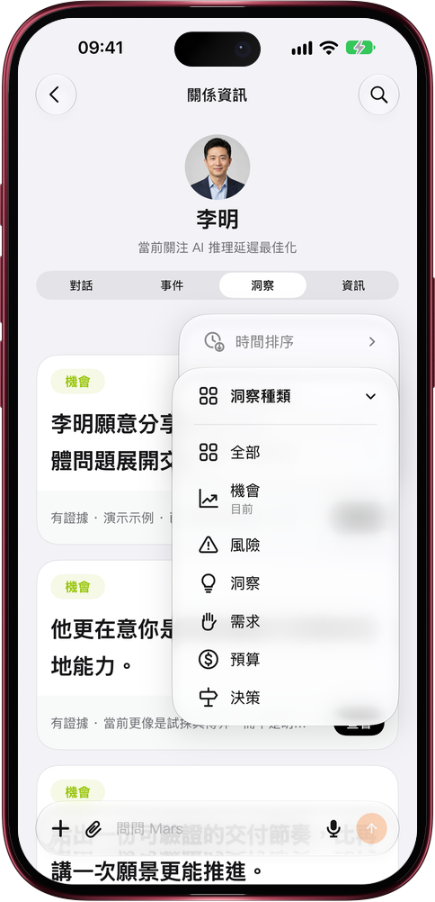

# 洞察一多，先看你要的那一類

> **預覽** · 2026-10-31 · `0.1.1.9443`
> 以下功能目前處於預覽階段，尚未正式上線。

一個人攢了十幾條洞察，想找那條機會卻要從頭翻？

在聯繫人的「洞察」頁，點橙色的排序按鈕：按時間排（置頂與未讀優先、最新、最早），按種類篩（機會、風險、洞察、需求、預算、決策），按狀態看（活躍、已退役、全部）。默認只顯示活躍洞察，已經失效的判斷不再混在裏面；想回看時選「已退役」，卡片會標出「已退役」。不用逐條翻找：要談合作就看機會，要防踩坑就看風險。網頁和 iOS 應用都能用。

每次打開聯繫人，先看到當下最該用的判斷。

*示意圖，使用虛構演示資料。*

*示意圖，使用虛構演示資料。*

[體驗預覽版](https://marsdata.ai/changelog/filter-relationship-insights) · [全部更新](../README.zh-HK.md)

[English](./crm-2026-10-31-filter-relationship-insights.md) · [简体中文](./crm-2026-10-31-filter-relationship-insights.zh-CN.md)
