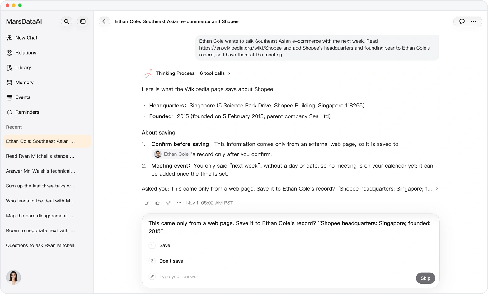
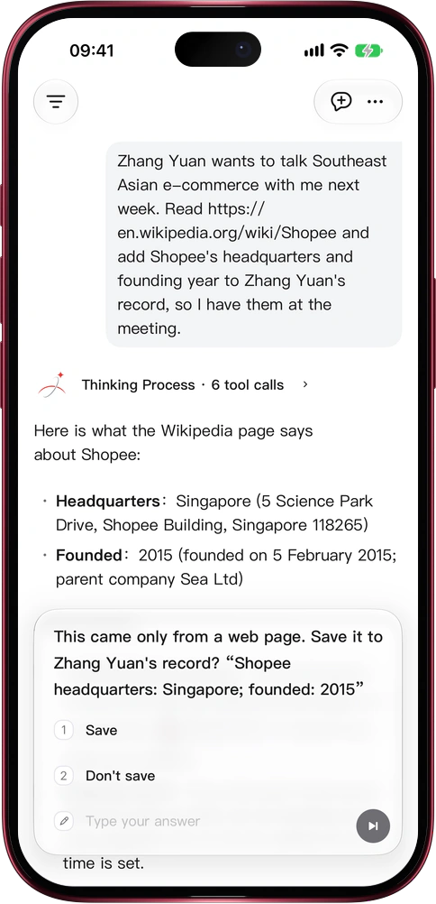

# From the web? Saved only on your say-so

> **Preview** · 2026-11-01 · `0.1.1.9572`
> These features are available in the preview version and have not been generally released.

Not everything on the web is true, and one wrong detail in a contact's record misleads you for months.

Ask Mars to read a page and file what it finds about someone. When a value comes only from that page, and not from you or your existing records, Mars quotes it back in one short question: Save, or Don't save. Nothing from the page is written until you choose Save. What you tell Mars yourself is saved as before, with no extra tap. Requests hidden inside a page are read as content, never as orders: a page cannot get Mars to send your information to another site. It works on the web and in the iOS app.

Anything from the web that lands in your records is something you approved.

*Illustration using fictional demo data.*

*Illustration using fictional demo data.*

[Explore the preview](https://marsdata.ai/changelog/confirm-before-saving-from-the-web) · [All updates](../README.md)

[简体中文](./crm-2026-11-01-confirm-before-saving-from-the-web.zh-CN.md) · [繁體中文](./crm-2026-11-01-confirm-before-saving-from-the-web.zh-HK.md)
