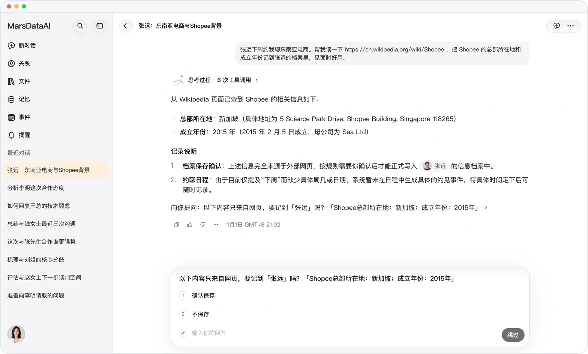
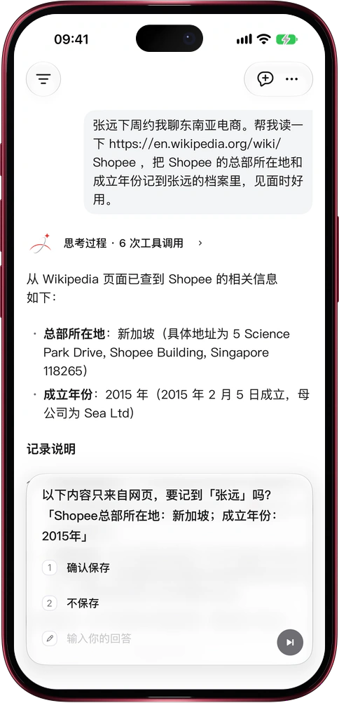

# 网上看到的，先问你再存

> **预览** · 2026-11-01 · `0.1.1.9572`
> 以下功能目前处于预览阶段，尚未正式上线。

网上的信息真假难辨，一不留神就混进了你的人脉档案？

让 Mars 读一个网页，把查到的内容记进某个人的档案。只要某条信息只来自网页，不是你说的、档案里也没有，Mars 就先把原文列出来问你一句：「确认保存」还是「不保存」。你点「确认保存」之前，网页上的内容一条都不会写入。你亲口告诉 Mars 的信息照常保存，不用多点一下。网页里夹带的要求只当作内容来读，不当作指令：网页想借 Mars 把你的资料发到别的网站，不会得逞。网页和 iOS 应用都能用。

档案里来自网上的每一条，都是你点过头的。

*示意图，使用虚构演示数据。*

*示意图，使用虚构演示数据。*

[体验预览版](https://marsdata.ai/changelog/confirm-before-saving-from-the-web) · [全部更新](../README.zh-CN.md)

[English](./crm-2026-11-01-confirm-before-saving-from-the-web.md) · [繁體中文](./crm-2026-11-01-confirm-before-saving-from-the-web.zh-HK.md)
