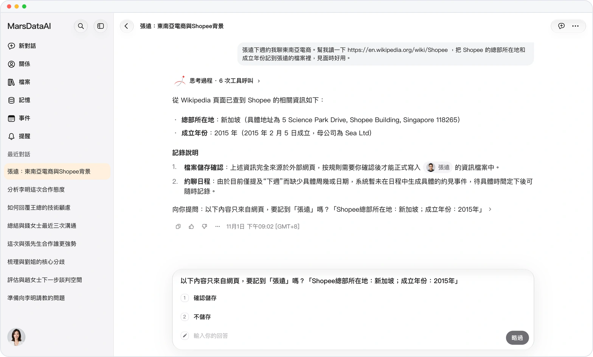
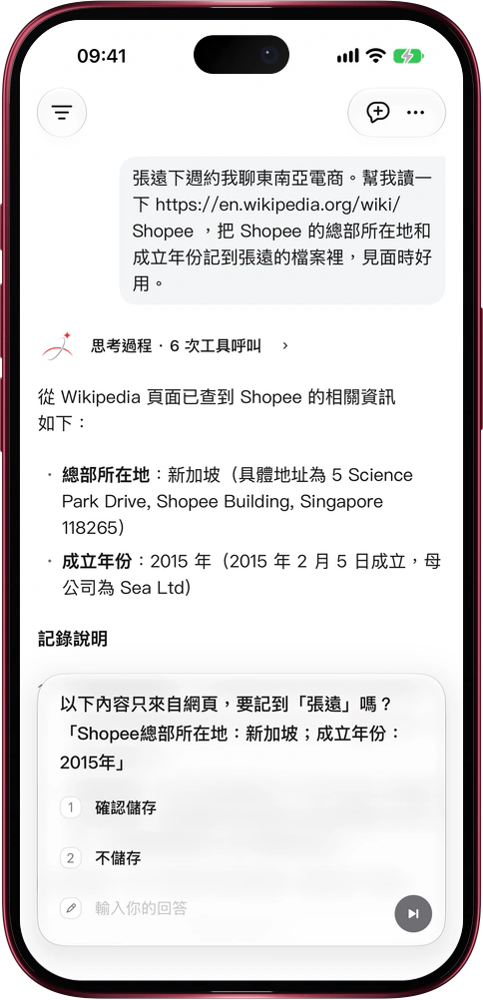

# 網上看到的，先問你再存

> **預覽** · 2026-11-01 · `0.1.1.9572`
> 以下功能目前處於預覽階段，尚未正式上線。

網上的信息真假難辨，一不留神就混進了你的人脈檔案？

讓 Mars 讀一個網頁，把查到的內容記進某個人的檔案。只要某條信息只來自網頁，不是你説的、檔案裏也沒有，Mars 就先把原文列出來問你一句：「確認保存」還是「不保存」。你點「確認保存」之前，網頁上的內容一條都不會寫入。你親口告訴 Mars 的信息照常保存，不用多點一下。網頁裏夾帶的要求只當作內容來讀，不當作指令：網頁想借 Mars 把你的資料發到別的網站，不會得逞。網頁和 iOS 應用都能用。

檔案裏來自網上的每一條，都是你點過頭的。

*示意圖，使用虛構演示資料。*

*示意圖，使用虛構演示資料。*

[體驗預覽版](https://marsdata.ai/changelog/confirm-before-saving-from-the-web) · [全部更新](../README.zh-HK.md)

[English](./crm-2026-11-01-confirm-before-saving-from-the-web.md) · [简体中文](./crm-2026-11-01-confirm-before-saving-from-the-web.zh-CN.md)
