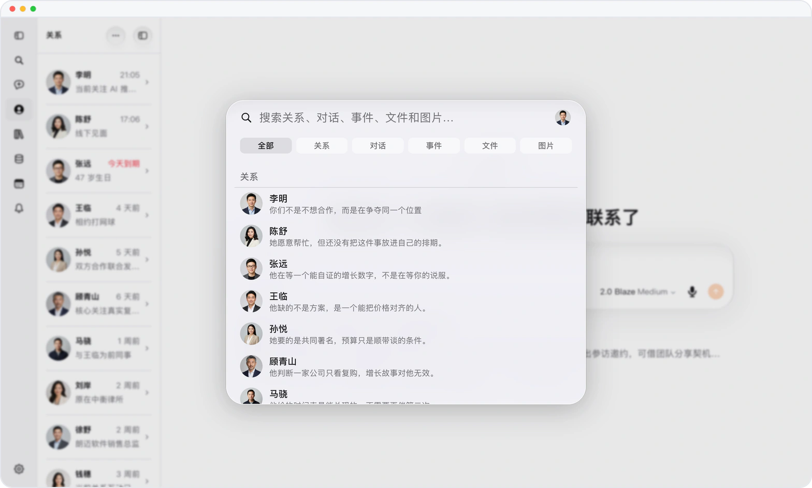

# 手不离键盘，Mars 随叫随到

> **预览** · 2026-11-02 · `0.1.1.9961`
> 以下功能目前处于预览阶段，尚未正式上线。

写到一半去找鼠标，思路就断了？

Mars 现在有一套快捷键，网页、Mac、iPad 和接了键盘的 iPhone 上都一样。⌘K 搜索对话、联系人和文件，⌘J 开新对话，⌘D 语音输入，⌘B 展开或收起侧栏；⌃⌘R、O、M、E、A 直接跳到关系、文件、记忆、事件和提醒。鼠标停在侧栏按钮上，提示里就标着按键，不用先背。Windows 和 Linux 的浏览器里，⌘ 换成 Ctrl，⌃⌘ 换成 Ctrl + Alt。学一次，每台设备都通用。

手不离键盘，在 Mars 里想去哪就去哪。

*示意图，使用虚构演示数据。*

*示意图，使用虚构演示数据。*

[体验预览版](https://marsdata.ai/changelog/keyboard-shortcuts-everywhere) · [全部更新](../README.zh-CN.md)

[English](./crm-2026-11-02-keyboard-shortcuts-everywhere.md) · [繁體中文](./crm-2026-11-02-keyboard-shortcuts-everywhere.zh-HK.md)
