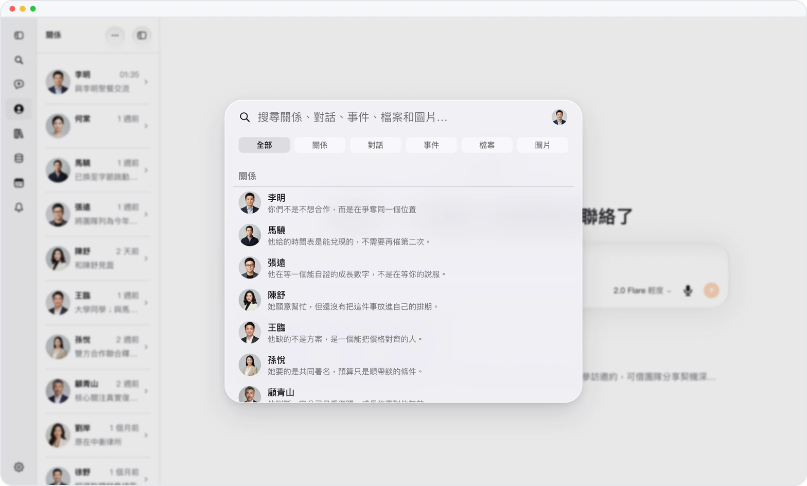

# 手不離鍵盤，Mars 隨叫隨到

> **預覽** · 2026-11-02 · `0.1.1.9961`
> 以下功能目前處於預覽階段，尚未正式上線。

寫到一半去找鼠標，思路就斷了？

Mars 現在有一套快捷鍵，網頁、Mac、iPad 和接了鍵盤的 iPhone 上都一樣。⌘K 搜索對話、聯繫人和文件，⌘J 開新對話，⌘D 語音輸入，⌘B 展開或收起側欄；⌃⌘R、O、M、E、A 直接跳到關係、文件、記憶、事件和提醒。鼠標停在側欄按鈕上，提示裏就標着按鍵，不用先背。Windows 和 Linux 的瀏覽器裏，⌘ 換成 Ctrl，⌃⌘ 換成 Ctrl + Alt。學一次，每台設備都通用。

手不離鍵盤，在 Mars 裏想去哪就去哪。

*示意圖，使用虛構演示資料。*

*示意圖，使用虛構演示資料。*

[體驗預覽版](https://marsdata.ai/changelog/keyboard-shortcuts-everywhere) · [全部更新](../README.zh-HK.md)

[English](./crm-2026-11-02-keyboard-shortcuts-everywhere.md) · [简体中文](./crm-2026-11-02-keyboard-shortcuts-everywhere.zh-CN.md)
