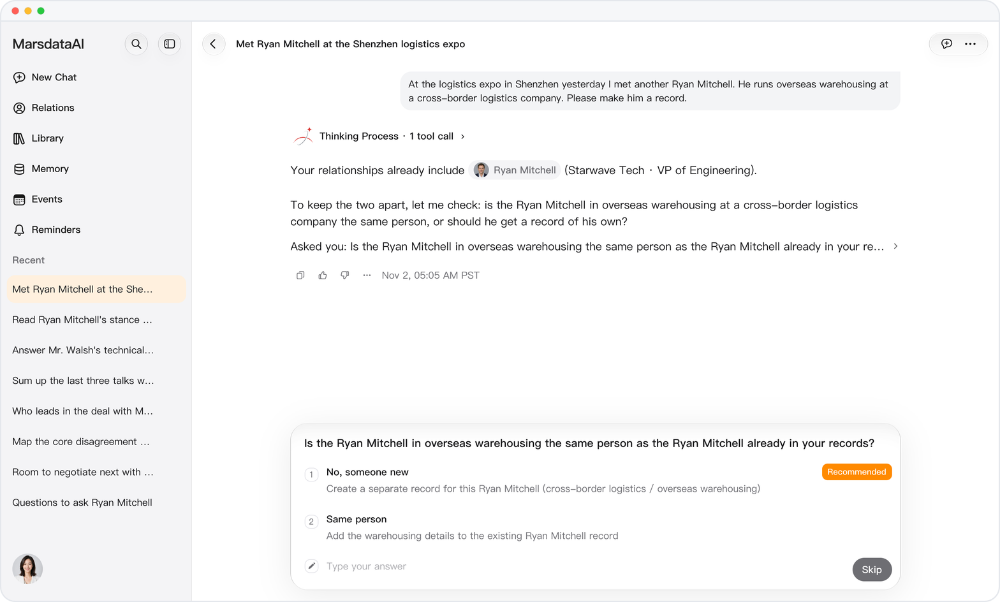
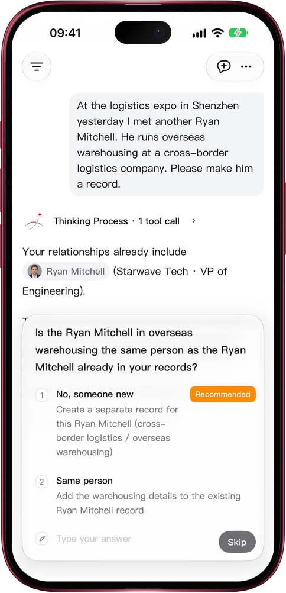

# Two people, one name? Mars asks first

> **Preview** · 2026-11-02 · `0.1.1.9961`
> These features are available in the preview version and have not been generally released.

Know two people called Li Ming? Their records should never blur into one.

Tell Mars about someone whose name, phone number, email or WeChat ID matches a person already in your relationships, and Mars asks one question first: the same person, or someone new? It names the person you already have, with their company or title, so you can tell at a glance. Pick an answer and Mars adds the details to that record or creates a separate one; it no longer reuses a namesake quietly. A phone number, email or WeChat ID belongs to one person, so saving one that another contact already has is stopped with a message. After you merge two people, links to the old record open the merged one. Works on the web and in the iOS app.

One record, one real person, so what Mars tells you about anyone is about the right one.

*Illustration using fictional demo data.*

*Illustration using fictional demo data.*

[Explore the preview](https://marsdata.ai/changelog/same-name-ask-first) · [All updates](../README.md)

[简体中文](./crm-2026-11-02-same-name-ask-first.zh-CN.md) · [繁體中文](./crm-2026-11-02-same-name-ask-first.zh-HK.md)
