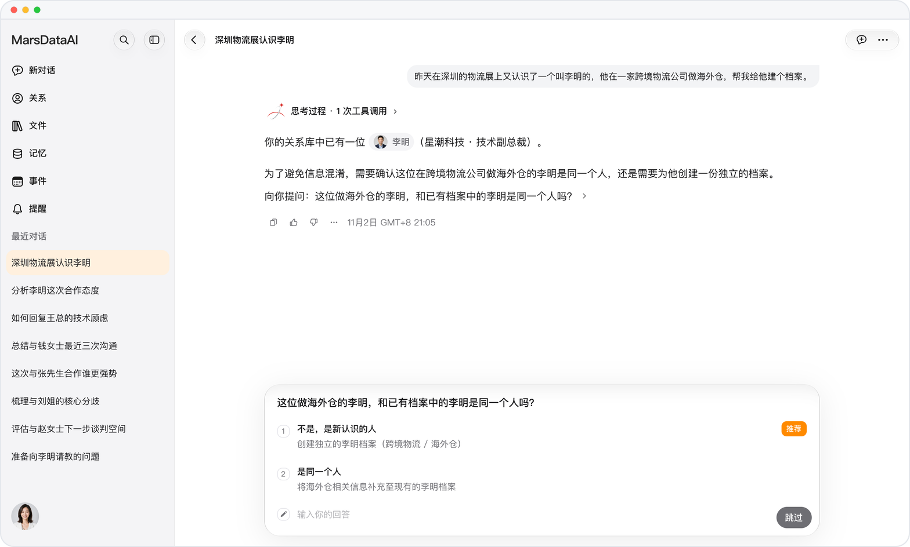
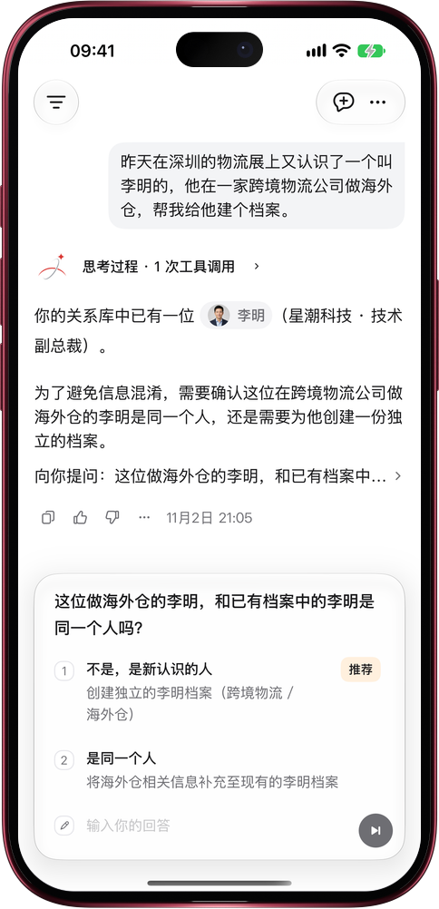

# 同名不同人，Mars 先问你

> **预览** · 2026-11-02 · `0.1.1.9961`
> 以下功能目前处于预览阶段，尚未正式上线。

认识两个李明，最怕档案混成一份？

跟 Mars 说起一个人，只要名字、手机号、邮箱或微信和关系库里已有的人对得上，Mars 就先问你一句：是同一个人，还是新认识的？它会列出你已有的那位和对方的公司或职位，一眼就能分清。你选好，Mars 再把信息补进原档案，或另建一份新档案，不再悄悄把同名的人当成一个。一个手机号、邮箱或微信只属于一个人，填了别人已有的会直接提示。两个人合并之后，旧档案的链接会直接打开合并后的那份。网页和 iOS 应用都能用。

一份档案对应一个真人，Mars 说起谁都不会张冠李戴。

*示意图，使用虚构演示数据。*

*示意图，使用虚构演示数据。*

[体验预览版](https://marsdata.ai/changelog/same-name-ask-first) · [全部更新](../README.zh-CN.md)

[English](./crm-2026-11-02-same-name-ask-first.md) · [繁體中文](./crm-2026-11-02-same-name-ask-first.zh-HK.md)
