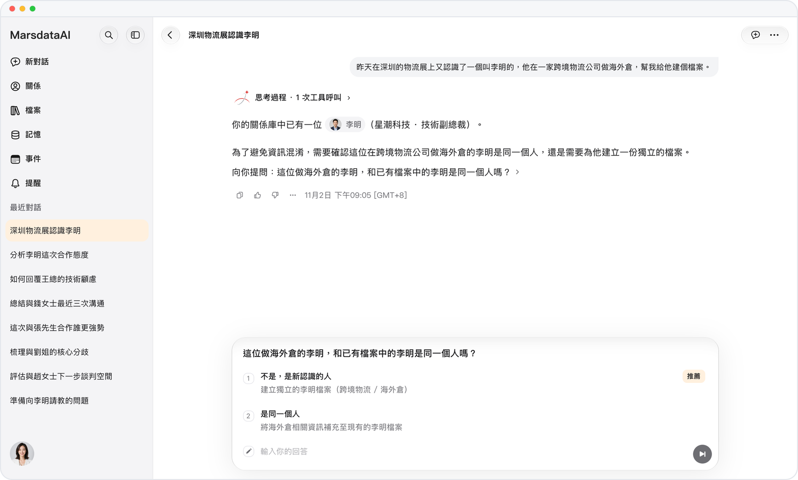
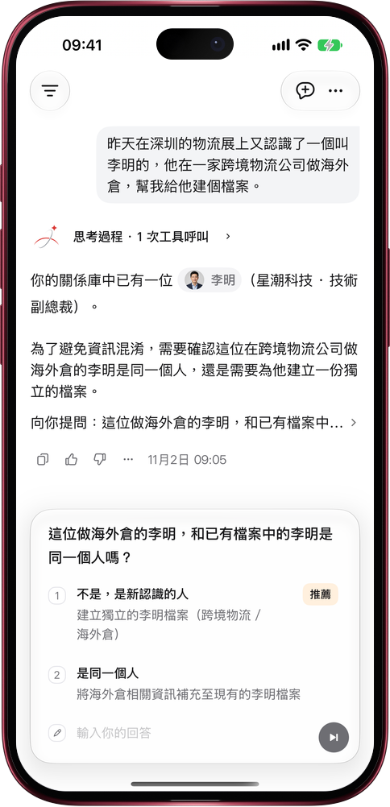

# 同名不同人，Mars 先問你

> **預覽** · 2026-11-02 · `0.1.1.9961`
> 以下功能目前處於預覽階段，尚未正式上線。

認識兩個李明，最怕檔案混成一份？

跟 Mars 説起一個人，只要名字、手機號、郵箱或微信和關係庫裏已有的人對得上，Mars 就先問你一句：是同一個人，還是新認識的？它會列出你已有的那位和對方的公司或職位，一眼就能分清。你選好，Mars 再把信息補進原檔案，或另建一份新檔案，不再悄悄把同名的人當成一個。一個手機號、郵箱或微信只屬於一個人，填了別人已有的會直接提示。兩個人合併之後，舊檔案的鏈接會直接打開合併後的那份。網頁和 iOS 應用都能用。

一份檔案對應一個真人，Mars 説起誰都不會張冠李戴。

*示意圖，使用虛構演示資料。*

*示意圖，使用虛構演示資料。*

[體驗預覽版](https://marsdata.ai/changelog/same-name-ask-first) · [全部更新](../README.zh-HK.md)

[English](./crm-2026-11-02-same-name-ask-first.md) · [简体中文](./crm-2026-11-02-same-name-ask-first.zh-CN.md)
