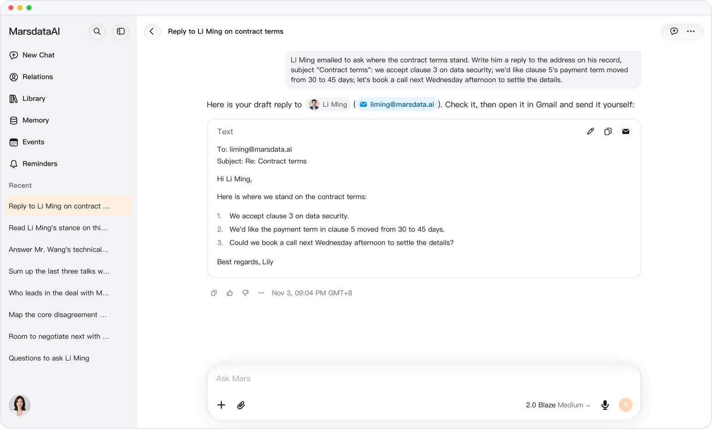
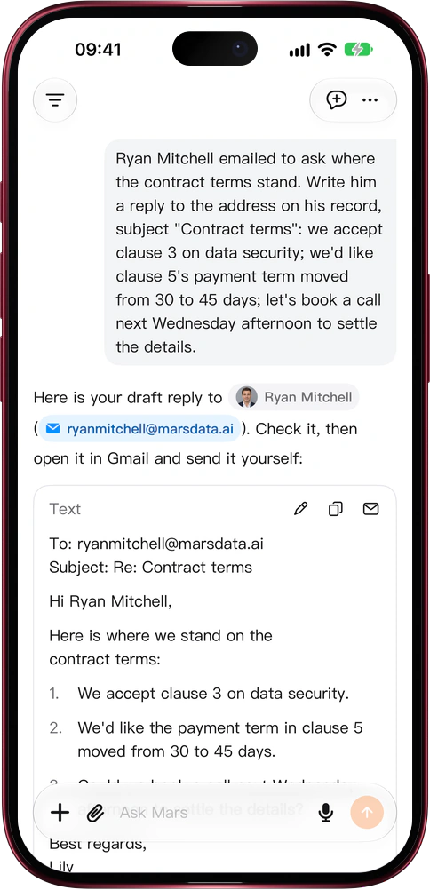

# Your reply, already waiting in Gmail

> **Preview** · 2026-11-03 · `0.1.1.10101`
> These features are available in the preview version and have not been generally released.

A drafted reply still meant copying the text, finding the address and retyping the subject.

Ask Mars to answer an email and the draft card opens with the recipient, Cc and subject lines, taken from the original sender or the person's record. Beside Edit and Copy sits a Gmail button: one tap opens a Gmail compose window with the recipient, subject and body already filled in, in a new tab on the web, and in the Gmail app on iOS, or the browser when the app isn't installed. Copy takes only the body. No pasting between apps, no retyping addresses.

From draft to sent is one look and one tap in Gmail. Mars never sends mail for you.

*Illustration using fictional demo data.*

*Illustration using fictional demo data.*

[Explore the preview](https://marsdata.ai/changelog/email-reply-open-in-gmail) · [All updates](../README.md)

[简体中文](./crm-2026-11-03-email-reply-open-in-gmail.zh-CN.md) · [繁體中文](./crm-2026-11-03-email-reply-open-in-gmail.zh-HK.md)
