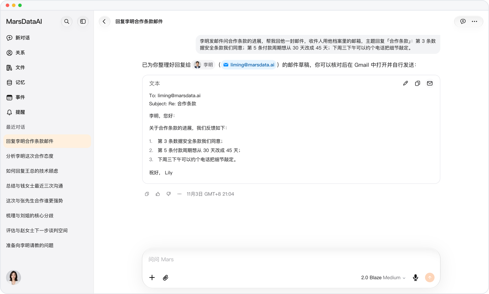
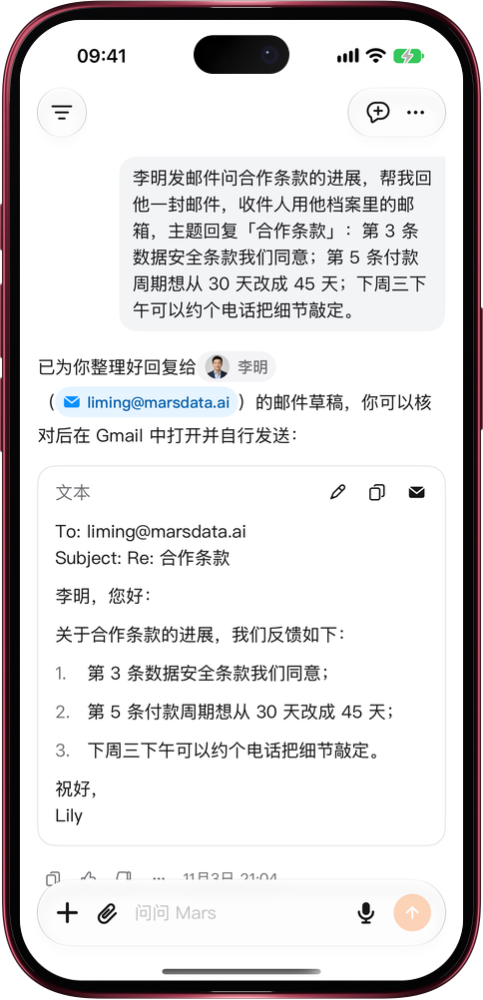

# 回信写好，Gmail 一点就开

> **预览** · 2026-11-03 · `0.1.1.10101`
> 以下功能目前处于预览阶段，尚未正式上线。

回信写好了，还得复制正文、翻收件人、再补一遍主题？

让 Mars 回一封邮件，草稿卡片开头就是收件人、抄送和主题，地址取自原邮件的发件人或对方的档案。卡片右上角，编辑、复制旁边多了一个 Gmail 按钮：点一下，Gmail 写信窗口打开，收件人、主题和正文都已填好。网页上在新标签页打开；iOS 应用优先打开 Gmail App，没装就用浏览器。复制按钮只复制正文。不用在两个应用之间来回粘贴，也不用再手敲一遍邮箱地址。

从草稿到发出，只差你在 Gmail 里看一眼、点一下发送；Mars 从不替你发信。

*示意图，使用虚构演示数据。*

*示意图，使用虚构演示数据。*

[体验预览版](https://marsdata.ai/changelog/email-reply-open-in-gmail) · [全部更新](../README.zh-CN.md)

[English](./crm-2026-11-03-email-reply-open-in-gmail.md) · [繁體中文](./crm-2026-11-03-email-reply-open-in-gmail.zh-HK.md)
