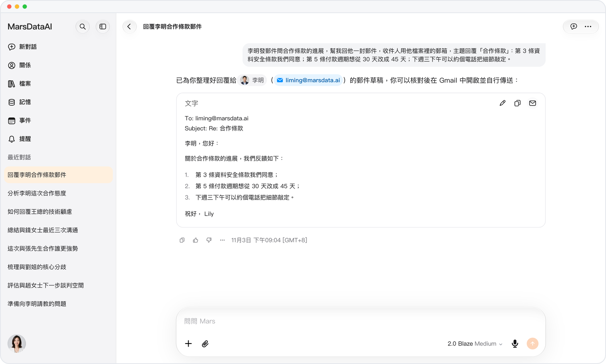
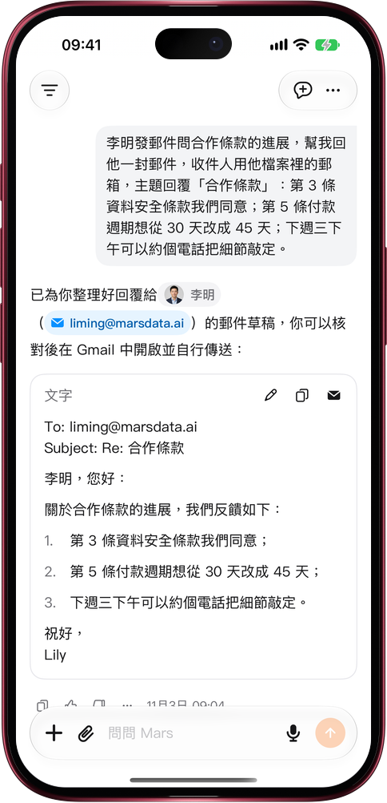

# 回信寫好，Gmail 一點就開

> **預覽** · 2026-11-03 · `0.1.1.10101`
> 以下功能目前處於預覽階段，尚未正式上線。

回信寫好了，還得複製正文、翻收件人、再補一遍主題？

讓 Mars 回一封郵件，草稿卡片開頭就是收件人、抄送和主題，地址取自原郵件的發件人或對方的檔案。卡片右上角，編輯、複製旁邊多了一個 Gmail 按鈕：點一下，Gmail 寫信窗口打開，收件人、主題和正文都已填好。網頁上在新標籤頁打開；iOS 應用優先打開 Gmail App，沒裝就用瀏覽器。複製按鈕只複製正文。不用在兩個應用之間來回粘貼，也不用再手敲一遍郵箱地址。

從草稿到發出，只差你在 Gmail 裏看一眼、點一下發送；Mars 從不替你發信。

*示意圖，使用虛構演示資料。*

*示意圖，使用虛構演示資料。*

[體驗預覽版](https://marsdata.ai/changelog/email-reply-open-in-gmail) · [全部更新](../README.zh-HK.md)

[English](./crm-2026-11-03-email-reply-open-in-gmail.md) · [简体中文](./crm-2026-11-03-email-reply-open-in-gmail.zh-CN.md)
