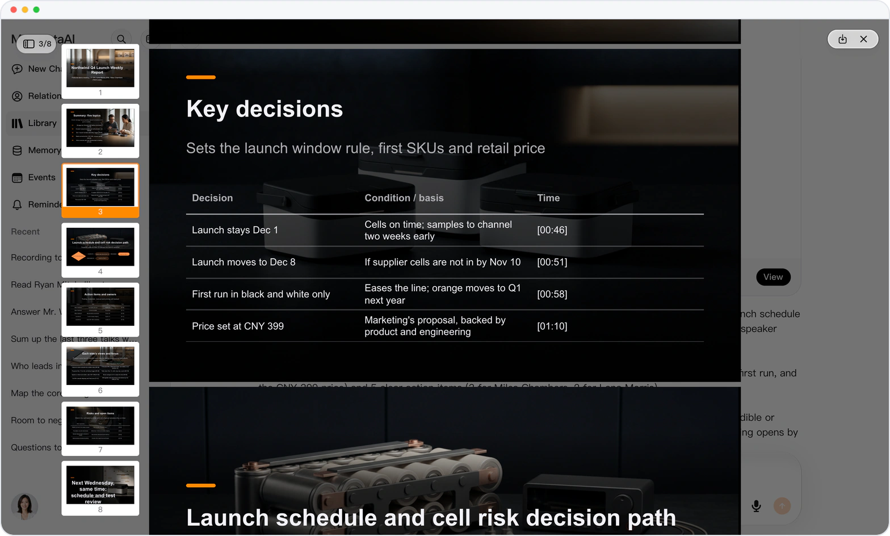
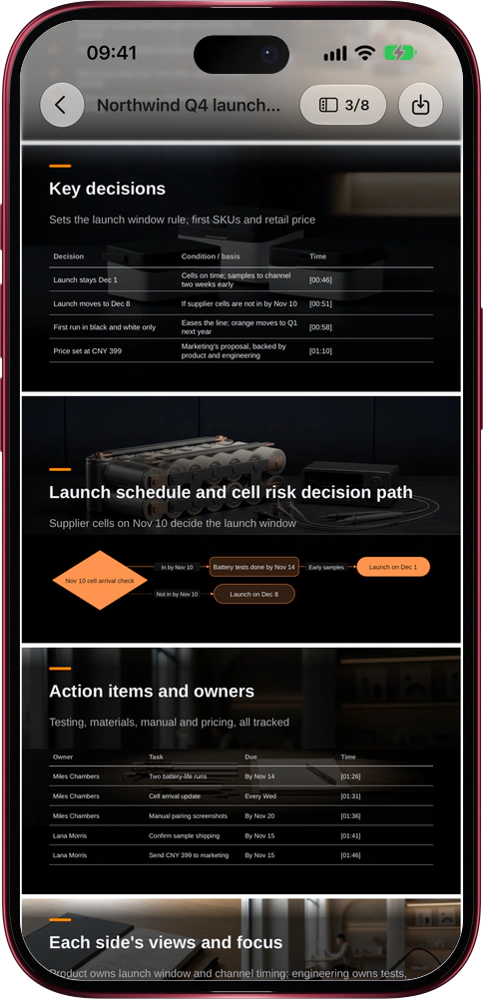

# Meeting recording in, report deck out

> **Preview** · 2026-11-03 · `0.1.1.10101`
> These features are available in the preview version and have not been generally released.

Minutes take an evening; turning them into slides takes another.

Attach a meeting recording in a conversation and say "turn this recording into a report deck". Mars listens to the whole meeting and builds an editable PowerPoint deck: a meeting summary, key decisions with their conditions kept whole, an action items table of owner, task, due date and time said, each side's views in one column per speaker, risks and open questions, and the next step. Every row carries its [mm:ss] time in the recording, and the speaker notes say who said it. Mars's own speaker recognition tells the voices apart and gives each line only to the voice that said it; names come only from the recording, from you or from a mapping you confirmed, and once confirmed, that person's lines and follow-ups land on their contact. Not a wall of transcript, and no copying minutes into slides by hand. Works on the web and in the iOS app.

The report is ready when the meeting is over. Download it and present; Mars never sends it to anyone for you.

*Illustration using fictional demo data.*

*Illustration using fictional demo data.*

[Explore the preview](https://marsdata.ai/changelog/meeting-recording-report-deck) · [All updates](../README.md)

[简体中文](./crm-2026-11-03-meeting-recording-report-deck.zh-CN.md) · [繁體中文](./crm-2026-11-03-meeting-recording-report-deck.zh-HK.md)
