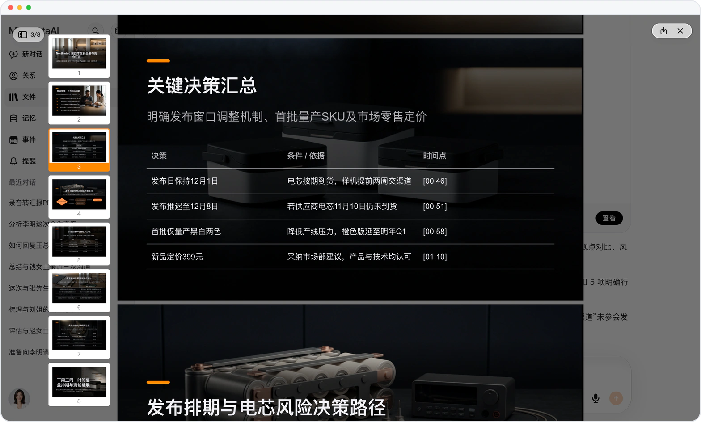
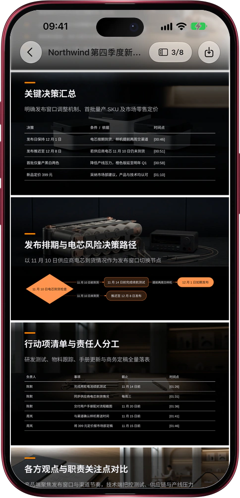

# 会议录音进来，汇报 PPT 出去

> **预览** · 2026-11-03 · `0.1.1.10101`
> 以下功能目前处于预览阶段，尚未正式上线。

整理纪要要一个晚上，做成汇报 PPT 又是一个晚上。

在对话里附上会议录音，说一句「把这段录音做成汇报 PPT」。Mars 把整场会听完，排出一份可编辑的 PowerPoint：会议概要；关键决策，连同「如果……就……」的条件；行动项表，列明负责人、事项、截止和时间点；各方观点，每位发言人一列；风险与待定；以及下一步安排。每一行都标着录音里的 [分:秒]，演讲备注写明是谁说的。Mars 自带说话人识别，分得清录音里的每个声音，每句话只归给真正说出它的人；名字只来自录音、你的告知或你确认过的对应关系，确认之后，他说的话和后续跟进都记到他名下。不是一大段转写稿，也不用把纪要一句句搬进 PPT。网页和 iOS 应用都能用。

会开完，汇报就备好了。下载就能讲；Mars 从不替你把它发给任何人。

*示意图，使用虚构演示数据。*

*示意图，使用虚构演示数据。*

[体验预览版](https://marsdata.ai/changelog/meeting-recording-report-deck) · [全部更新](../README.zh-CN.md)

[English](./crm-2026-11-03-meeting-recording-report-deck.md) · [繁體中文](./crm-2026-11-03-meeting-recording-report-deck.zh-HK.md)
