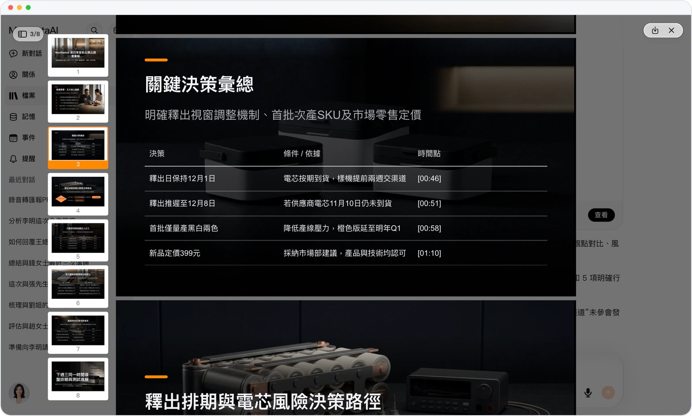
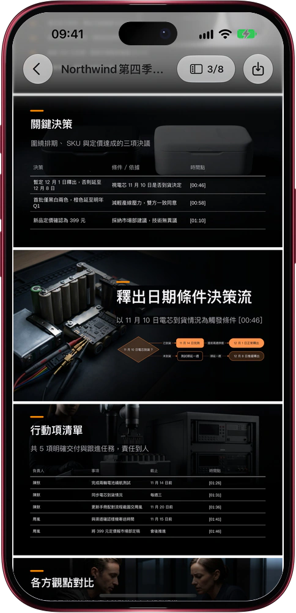

# 會議錄音進來，彙報 PPT 出去

> **預覽** · 2026-11-03 · `0.1.1.10101`
> 以下功能目前處於預覽階段，尚未正式上線。

整理紀要要一個晚上，做成彙報 PPT 又是一個晚上。

在對話裏附上會議錄音，説一句「把這段錄音做成彙報 PPT」。Mars 把整場會聽完，排出一份可編輯的 PowerPoint：會議概要；關鍵決策，連同「如果……就……」的條件；行動項表，列明負責人、事項、截止和時間點；各方觀點，每位發言人一列；風險與待定；以及下一步安排。每一行都標着錄音裏的 [分:秒]，演講備註寫明是誰説的。Mars 自帶説話人識別，分得清錄音裏的每個聲音，每句話只歸給真正説出它的人；名字只來自錄音、你的告知或你確認過的對應關係，確認之後，他説的話和後續跟進都記到他名下。不是一大段轉寫稿，也不用把紀要一句句搬進 PPT。網頁和 iOS 應用都能用。

會開完，彙報就備好了。下載就能講；Mars 從不替你把它發給任何人。

*示意圖，使用虛構演示資料。*

*示意圖，使用虛構演示資料。*

[體驗預覽版](https://marsdata.ai/changelog/meeting-recording-report-deck) · [全部更新](../README.zh-HK.md)

[English](./crm-2026-11-03-meeting-recording-report-deck.md) · [简体中文](./crm-2026-11-03-meeting-recording-report-deck.zh-CN.md)
