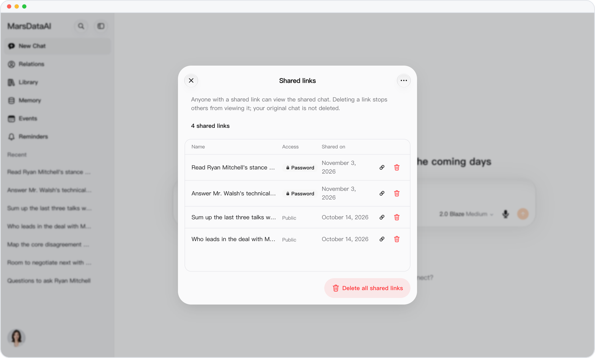
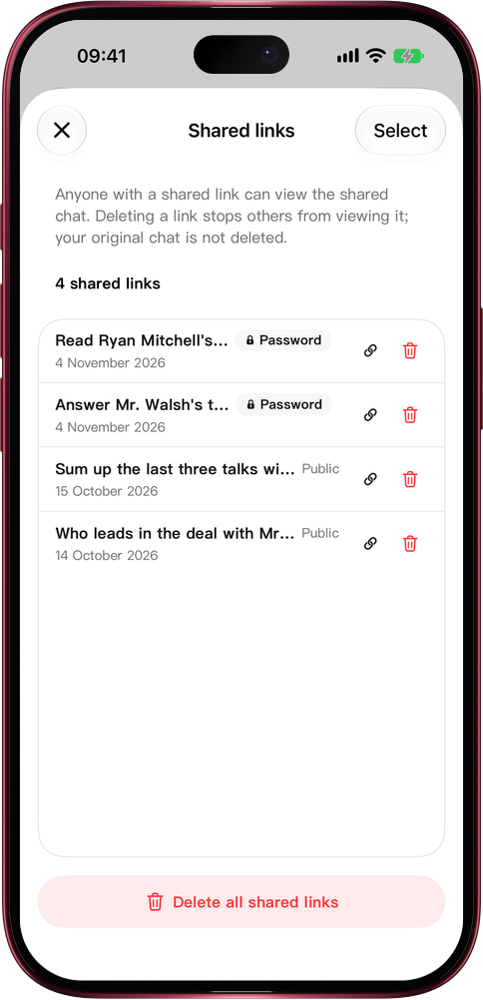

# Shared links, managed from a single list

> **Preview** · 2026-11-04 · `0.1.1.10457`
> These features are available in the preview version and have not been generally released.

Share a few conversations and you lose track: which links are still out there, and which ones ask for a password?

Copy a share link and a notice pops up; tap Manage links to open Shared links. Every link you have shared is listed there with its name, its access (password-protected or public) and the date you shared it. Copy or delete any link from its row, tap Select to copy or delete several at once, or turn every link off with Delete all shared links. Each delete asks first, and only the link goes: the original conversation stays. No more opening conversations one by one to find what you shared. Works on the web and in the iOS app.

See at a glance who can read your conversations, and take any link back whenever you want.

*Illustration using fictional demo data.*

*Illustration using fictional demo data.*

[Explore the preview](https://marsdata.ai/changelog/manage-shared-links) · [All updates](../README.md)

[简体中文](./crm-2026-11-04-manage-shared-links.zh-CN.md) · [繁體中文](./crm-2026-11-04-manage-shared-links.zh-HK.md)
