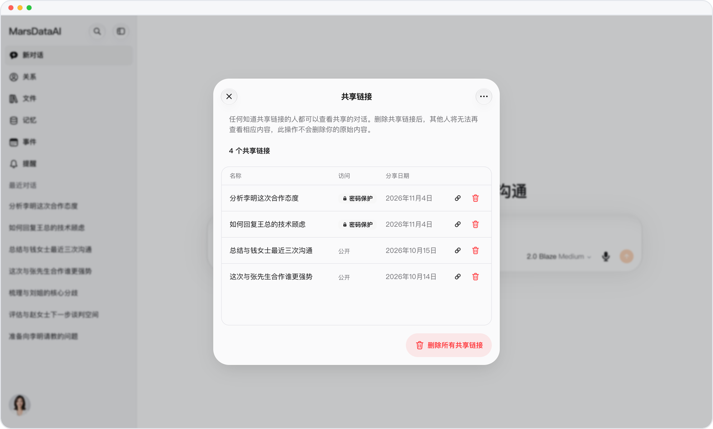
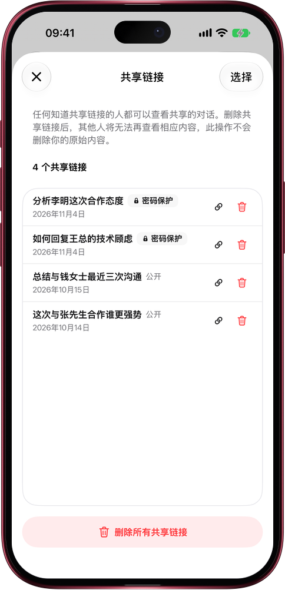

# 分享过的链接，一页管齐

> **预览** · 2026-11-04 · `0.1.1.10457`
> 以下功能目前处于预览阶段，尚未正式上线。

对话分享多了，就记不清：哪些链接还在外面，哪些设了密码？

复制分享链接后会弹出一条提示，点「管理链接」就打开「共享链接」：你分享过的每一条链接都列在这里，名称、访问方式（密码保护或公开）、分享日期一目了然。每一行都能直接复制或删除；点「选择」，一次复制或删除好几条；「删除所有共享链接」一下全部收回。每次删除都会先确认，删掉的只是链接，原对话照样保留。不用再一段段翻回对话去找分享入口。网页和 iOS 应用都能用。

谁能看到你的对话，一页看清，想收回随时收回。

*示意图，使用虚构演示数据。*

*示意图，使用虚构演示数据。*

[体验预览版](https://marsdata.ai/changelog/manage-shared-links) · [全部更新](../README.zh-CN.md)

[English](./crm-2026-11-04-manage-shared-links.md) · [繁體中文](./crm-2026-11-04-manage-shared-links.zh-HK.md)
