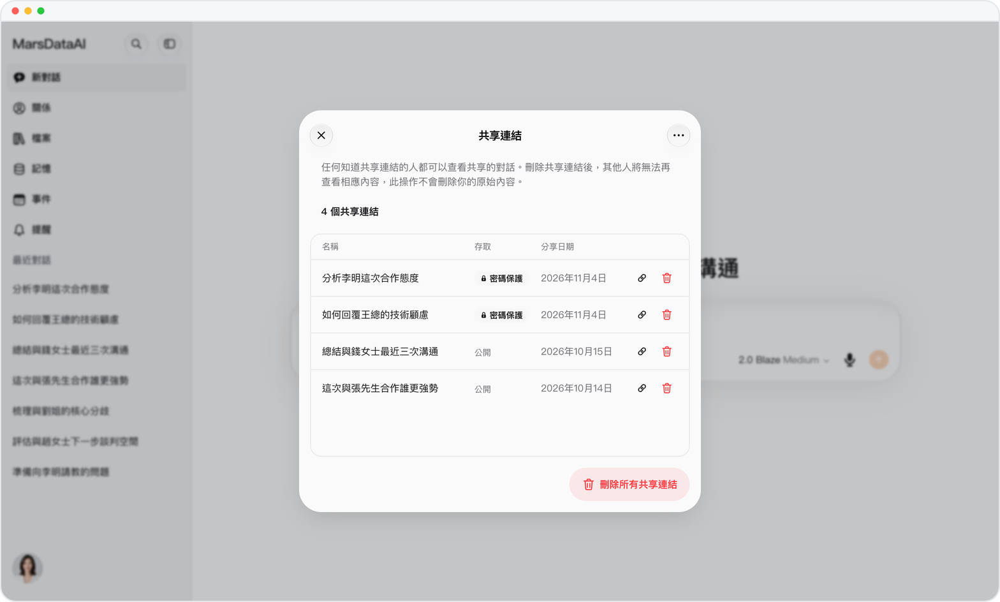
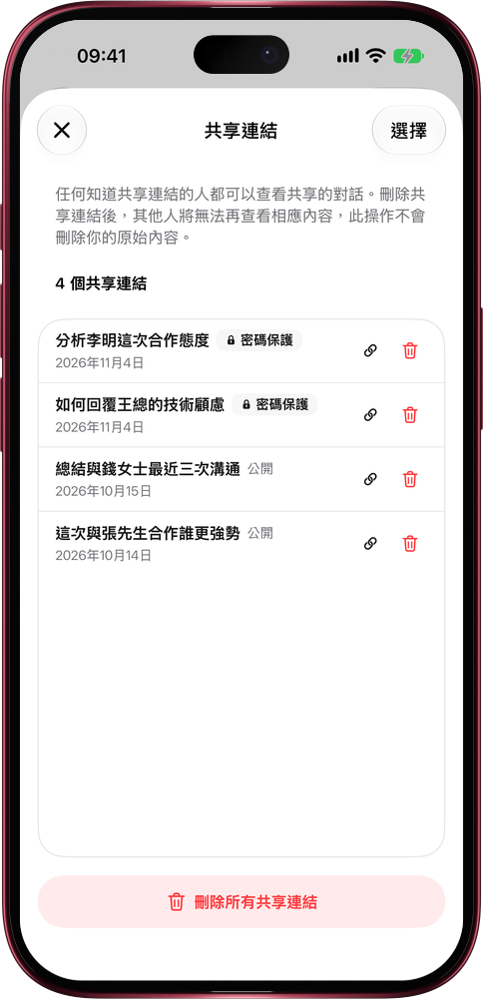

# 分享過的鏈接，一頁管齊

> **預覽** · 2026-11-04 · `0.1.1.10457`
> 以下功能目前處於預覽階段，尚未正式上線。

對話分享多了，就記不清：哪些鏈接還在外面，哪些設了密碼？

複製分享鏈接後會彈出一條提示，點「管理鏈接」就打開「共享鏈接」：你分享過的每一條鏈接都列在這裏，名稱、訪問方式（密碼保護或公開）、分享日期一目瞭然。每一行都能直接複製或刪除；點「選擇」，一次複製或刪除好幾條；「刪除所有共享鏈接」一下全部收回。每次刪除都會先確認，刪掉的只是鏈接，原對話照樣保留。不用再一段段翻回對話去找分享入口。網頁和 iOS 應用都能用。

誰能看到你的對話，一頁看清，想收回隨時收回。

*示意圖，使用虛構演示資料。*

*示意圖，使用虛構演示資料。*

[體驗預覽版](https://marsdata.ai/changelog/manage-shared-links) · [全部更新](../README.zh-HK.md)

[English](./crm-2026-11-04-manage-shared-links.md) · [简体中文](./crm-2026-11-04-manage-shared-links.zh-CN.md)
