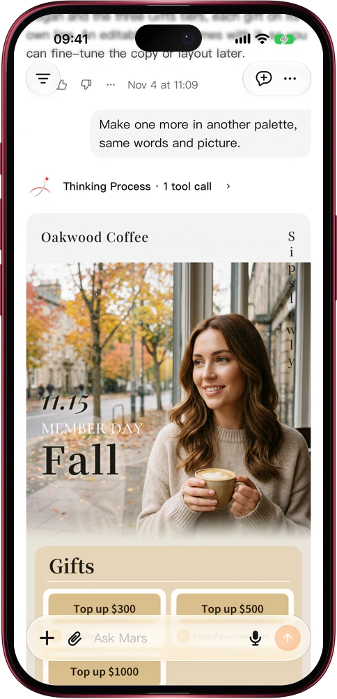

# Posters with every price and date right

> **Preview** · 2026-11-04 · `0.1.1.10253`
> These features are available in the preview version and have not been generally released.

AI posters look great until you read them: a price off by a digit, a garbled date, every word to check by hand.

Tell Mars what the poster is for and give it the words: brand, title, date, slogan, price tiers. The image model paints only the picture, with no lettering in it; every word is set by Mars's own poster engine, so prices, dates and names come straight from your request instead of being drawn by a model. Eight layouts ship first: film poster, East-Asian whitespace, price offers, figure in front of a giant word, giant glyph, words as windows, minimal ceremony and hazy light. Mars picks the ones that suit your copy and hands you up to four candidates in one go. Each is a PNG plus a portrait .pptx whose words are real text boxes, so it opens and edits in PowerPoint, Keynote and WPS. Want another palette or layout? Say so: the picture is reused, not redrawn. A line too long for a layout is never cut off; Mars shortens it or drops that layout. No proofreading machine-drawn letters, no rebuilding the design by hand. Works on the web and in the iOS app.

Once the copy is final, so is the poster: post the PNG today, or open the .pptx and change a line whenever you like.

*Illustration using fictional demo data.*

*Illustration using fictional demo data.*

[Explore the preview](https://marsdata.ai/changelog/posters-with-exact-words) · [All updates](../README.md)

[简体中文](./crm-2026-11-04-posters-with-exact-words.zh-CN.md) · [繁體中文](./crm-2026-11-04-posters-with-exact-words.zh-HK.md)
