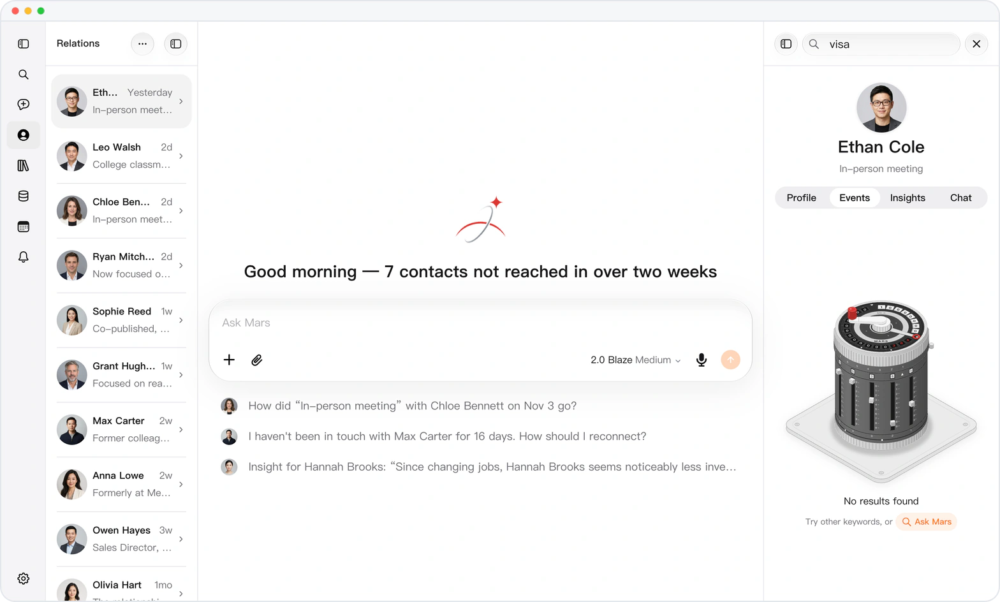
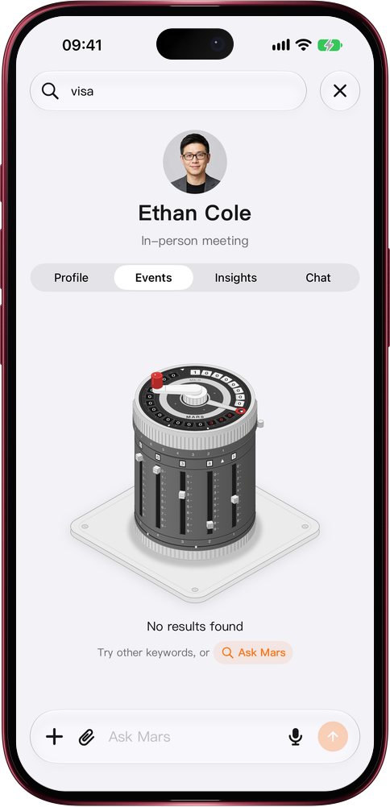

# Search came up empty? Hand it to Mars

> **Preview** · 2026-11-05 · `0.1.1.10670`
> These features are available in the preview version and have not been generally released.

A search box only matches the exact words you type. Phrase it differently and you hit an empty page and a dead end.

Search any tab of a contact's page (information, events, insights or conversations) or your Library. When nothing matches, the empty result now ends with an Ask Mars capsule. Tap it and a new conversation opens with the question written for you, asking for that contact's events, insights, information or conversations about the word you searched, with the contact already attached as a capsule. Send it as it is or edit it first. In the Library, Mars asks for files on that word, and attaches the contact when the word is exactly someone's name. No retyping, no starting the question from scratch: the dead end becomes a question Mars can work on. Works on the web and in the iOS app.

An empty search is no longer the end of the road: one tap, and Mars picks up the question.

*Illustration using fictional demo data.*

*Illustration using fictional demo data.*

[Explore the preview](https://marsdata.ai/changelog/ask-mars-when-search-misses) · [All updates](../README.md)

[简体中文](./crm-2026-11-05-ask-mars-when-search-misses.zh-CN.md) · [繁體中文](./crm-2026-11-05-ask-mars-when-search-misses.zh-HK.md)
