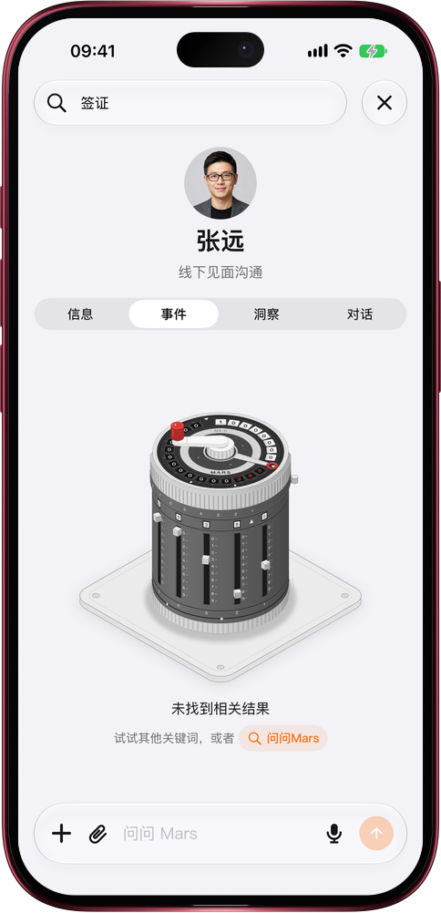

# 搜不到？一点交给 Mars 去找

> **预览** · 2026-11-05 · `0.1.1.10670`
> 以下功能目前处于预览阶段，尚未正式上线。

搜索框只认你敲下的那几个字，换个说法就是一片空白，只能干瞪眼。

在联系人页的任意一栏（信息、事件、洞察、对话）或资料库里搜索，搜不到时，空结果下方多了一个「问问Mars」。点一下就打开新对话，问题已经替你写好，比如「帮我找有关 @张远 的「签证」相关事件」，联系人直接带成胶囊；可以直接发送，也可以先改几个字。在资料库里，Mars 会帮你找这个词相关的文件；搜的正好是某位联系人的名字时，也会把这个人带上。不用重新打字，也不用从头组织问题：搜索的死胡同，变成一句 Mars 接得住的提问。网页和 iOS 应用都能用。

搜不到不再是终点：点一下，Mars 接着帮你找。

*示意图，使用虚构演示数据。*

*示意图，使用虚构演示数据。*

[体验预览版](https://marsdata.ai/changelog/ask-mars-when-search-misses) · [全部更新](../README.zh-CN.md)

[English](./crm-2026-11-05-ask-mars-when-search-misses.md) · [繁體中文](./crm-2026-11-05-ask-mars-when-search-misses.zh-HK.md)
