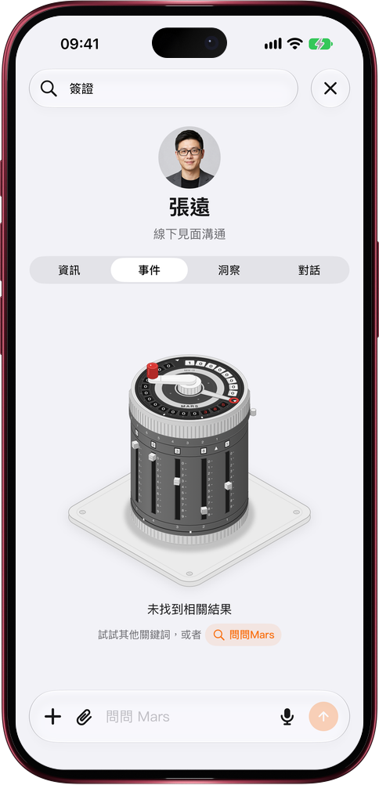

# 搜不到？直接交給 Mars 去找

> **預覽** · 2026-11-05 · `0.1.1.10670`
> 以下功能目前處於預覽階段，尚未正式上線。

搜索框只認你敲下的那幾個字，換個説法就是一片空白，只能乾瞪眼。

在聯繫人頁的任意一欄（信息、事件、洞察、對話）或資料庫裏搜索，搜不到時，空結果下方多了一個「問問Mars」。點一下就打開新對話，問題已經替你寫好，比如「幫我找有關 @張遠 的「簽證」相關事件」，聯繫人直接帶成膠囊；可以直接發送，也可以先改幾個字。在資料庫裏，Mars 會幫你找這個詞相關的文件；搜的正好是某位聯繫人的名字時，也會把這個人帶上。不用重新打字，也不用從頭組織問題：搜索的死衚衕，變成一句 Mars 接得住的提問。網頁和 iOS 應用都能用。

搜不到不再是終點：點一下，Mars 接着幫你找。

*示意圖，使用虛構演示資料。*

*示意圖，使用虛構演示資料。*

[體驗預覽版](https://marsdata.ai/changelog/ask-mars-when-search-misses) · [全部更新](../README.zh-HK.md)

[English](./crm-2026-11-05-ask-mars-when-search-misses.md) · [简体中文](./crm-2026-11-05-ask-mars-when-search-misses.zh-CN.md)
