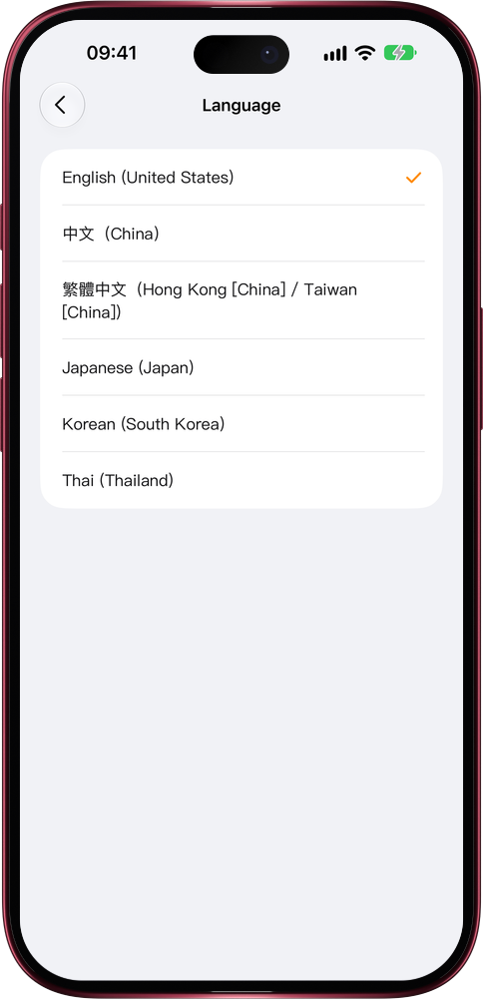

# Mars, now in Japanese, Korean and Thai

> **Preview** · 2026-11-07 · `0.1.1.11027`
> These features are available in the preview version and have not been generally released.

In an app that is not in your language, every button costs a moment of translation.

Settings › Language now lists 日本語, 한국어 and ไทย beside Simplified Chinese, Traditional Chinese and English, on the web and in the iOS app on iPhone, iPad and Mac. On first launch Mars follows your device language, so a Japanese, Korean or Thai device opens straight into it. The whole app switches: onboarding, menus, permission prompts, Siri phrases and widgets, in type suited to each script, with dates written the way each language writes them and Thai dates in Gregorian years. Voice input listens in Japanese, Korean or Thai, and a new field Mars saves on a contact is named in your language. Anything not translated yet reads English, never Chinese. No second language to lean on, no guessing at buttons: Mars works the way you think.

From the first screen, you read, speak and work with Mars in your own language.

*Illustration using fictional demo data.*

*Illustration using fictional demo data.*

[Explore the preview](https://marsdata.ai/changelog/mars-in-japanese-korean-thai) · [All updates](../README.md)

[简体中文](./crm-2026-11-07-mars-in-japanese-korean-thai.zh-CN.md) · [繁體中文](./crm-2026-11-07-mars-in-japanese-korean-thai.zh-HK.md)
