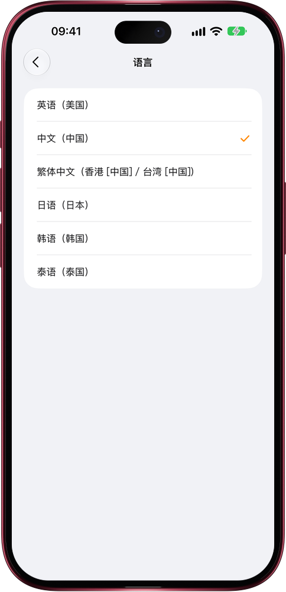

# 日语、韩语、泰语用户，打开就是母语

> **预览** · 2026-11-07 · `0.1.1.11027`
> 以下功能目前处于预览阶段，尚未正式上线。

用不是母语的应用，每个按钮都得先在脑子里翻译一遍。

「设置 › 语言」里，在简体中文、繁體中文和 English 之外新增了日本語、한국어和ไทย，网页版和 iPhone、iPad、Mac 上的 iOS 应用都能选。首次打开时 Mars 跟随设备语言，日语、韩语、泰语设备一打开就是母语界面。整个应用一起切换：引导页、菜单、权限提示、Siri 短语和小组件，配上适合各自文字的字体；日期按各语言的习惯书写，泰语日期用公历年份。语音输入能听懂日语、韩语和泰语，Mars 给联系人新记的信息，名称也用你的语言。还没翻译到的文字显示英文，绝不会冒出中文。不用借第二语言，也不用猜按钮：Mars 跟着你的思路走。

从第一屏开始，用母语和 Mars 一起做事。

*示意图，使用虚构演示数据。*

*示意图，使用虚构演示数据。*

[体验预览版](https://marsdata.ai/changelog/mars-in-japanese-korean-thai) · [全部更新](../README.zh-CN.md)

[English](./crm-2026-11-07-mars-in-japanese-korean-thai.md) · [繁體中文](./crm-2026-11-07-mars-in-japanese-korean-thai.zh-HK.md)
