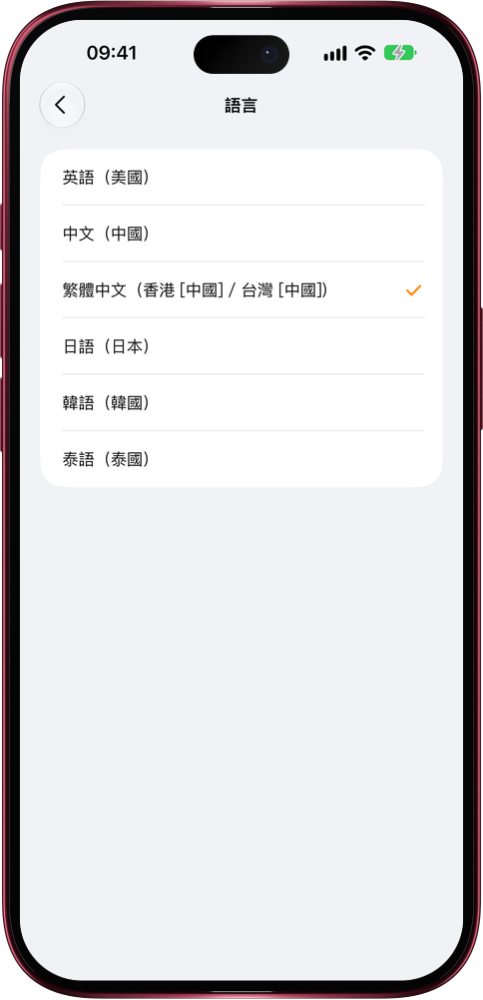

# 日語、韓語、泰語用户，打開就是母語

> **預覽** · 2026-11-07 · `0.1.1.11027`
> 以下功能目前處於預覽階段，尚未正式上線。

用不是母語的應用，每個按鈕都得先在腦子裏翻譯一遍。

「設置 › 語言」裏，在簡體中文、繁體中文和 English 之外新增了日本語、한국어和ไทย，網頁版和 iPhone、iPad、Mac 上的 iOS 應用都能選。首次打開時 Mars 跟隨設備語言，日語、韓語、泰語設備一打開就是母語界面。整個應用一起切換：引導頁、菜單、權限提示、Siri 短語和小組件，配上適合各自文字的字體；日期按各語言的習慣書寫，泰語日期用公曆年份。語音輸入能聽懂日語、韓語和泰語，Mars 給聯繫人新記的信息，名稱也用你的語言。還沒翻譯到的文字顯示英文，絕不會冒出中文。不用借第二語言，也不用猜按鈕：Mars 跟着你的思路走。

從第一屏開始，用母語和 Mars 一起做事。

*示意圖，使用虛構演示資料。*

*示意圖，使用虛構演示資料。*

[體驗預覽版](https://marsdata.ai/changelog/mars-in-japanese-korean-thai) · [全部更新](../README.zh-HK.md)

[English](./crm-2026-11-07-mars-in-japanese-korean-thai.md) · [简体中文](./crm-2026-11-07-mars-in-japanese-korean-thai.zh-CN.md)
