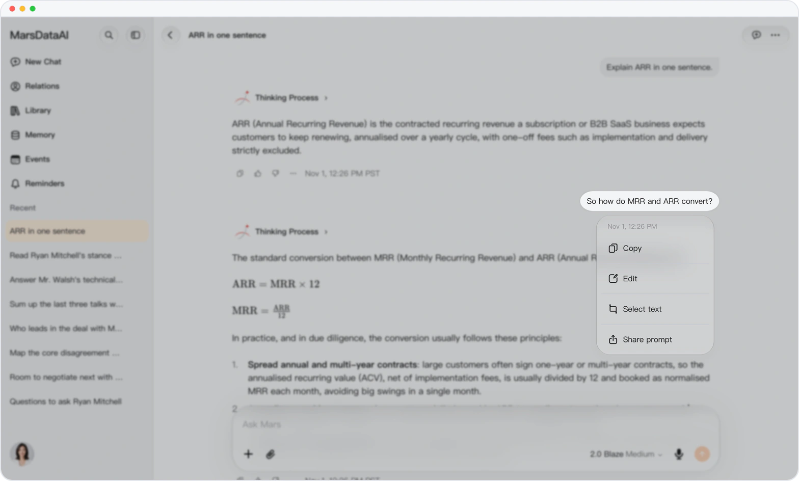
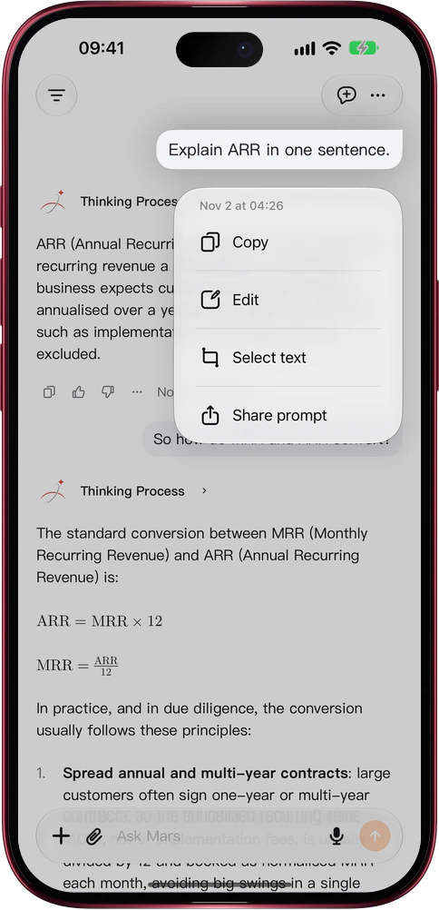

# Edit your question, get a fresh answer

> **Preview** · 2026-11-08 · `0.1.1.11207`
> These features are available in the preview version and have not been generally released.

You hit send, then realised what you actually meant to ask.

Press and hold, or right-click, a question you sent and choose Edit: your words drop back into the composer, ready to tweak and send. Edit your latest question and Mars answers the new version right where the old answer was. Edit an earlier one and Mars opens a branch that holds the conversation up to that question, then answers your edit there, leaving the original conversation untouched. Files attached to the question come along. It works on the web and in the iOS app on iPhone, iPad and Mac. No copying and pasting, no retyping, and no risk to a conversation you want to keep.

Rephrase the moment a better question comes to mind, and get the answer you were after.

*Illustration using fictional demo data.*

*Illustration using fictional demo data.*

[Explore the preview](https://marsdata.ai/changelog/edit-your-question) · [All updates](../README.md)

[简体中文](./crm-2026-11-08-edit-your-question.zh-CN.md) · [繁體中文](./crm-2026-11-08-edit-your-question.zh-HK.md)
